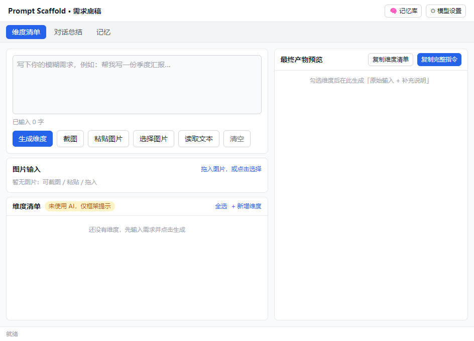

# Prompt Scaffold · Prompt Scaffold + Memory Notebook

> We don't just polish your prompts — we remind you of the dimensions you didn't think of.
> Local-first, privacy-first. AI is an **opt-in, off-by-default** enhancement.

**中文版：[README.zh-CN.md](./README.zh-CN.md)**

Prompt Scaffold is a local-first Electron desktop app composed of two top-level modules:

| Module | In a word |
|---|---|
| **Prompt Scaffold** | Type a vague request → surface the dimensions you might have missed (each with adoptable wording) → tick to compose a complete prompt |
| **Memory (Notebook)** | Lightweight note-taking: capture, review, materials, versions, search, backup — with optional AI summary / reminders |

Core philosophy: **we don't write prompts for you, and we don't decide for you** — we produce **tickable, editable raw material**, and the choices always stay in your hands.



---

## ✨ Features

### Prompt Scaffold
- Standalone window + system tray
- Input: text / one-click screenshot / paste from clipboard / drag-and-drop image
- Dimension list generation (structured JSON, via real LLM APIs)
- Conversation summarization (paste a multi-turn chat → core intent + dimensions)
- Share-link fetching (auto-extract text from public share pages, with manual-paste fallback)
- Bring your own model + key (Zhipu / DeepSeek / Ollama / custom)
- Images go through multimodal vision models; guided to switch model when unsupported
- Rule-based dimension pool fallback: with no key, falls back to local preset dimensions, **clearly labeled "AI not used"** — never fakes AI output

### Memory (Notebook)
- Note entries + day/week/month review + explicit cycle folders
- Material library: text/Markdown + PDF/Office binaries (content-addressed dedup + extracted-text search)
- Version control: history snapshots + rollback + cleanup reminders (by version count / size / time — suggests, never auto-deletes)
- Full-text search (MiniSearch, including extracted text from materials)
- Recycle bin (soft delete) + import/export + local backup/restore
- Memory library: visual view + import/export (merge/overwrite + conflict validation + dedup)

---

## 🔒 Privacy-first

Every AI capability (input enhancement / summarize / remind / code execution) is **independently configurable to three levels, all off by default**:

| Level | Meaning | Data flow |
|---|---|---|
| Off | No model called | Stays on-device 🟢 |
| Local model | On-device inference (Ollama, etc.) | Stays on-device 🟢 |
| External model | Cloud LLM API (your own key) | Leaves device ☁️ |

The "External" level adds a **send-scope** choice (all / selected only + field-level redaction), plus a **one-click kill switch** and **pre-send confirmation**. Data is stored locally by default — no automatic collection, no telemetry.

---

## 💻 Cross-platform (Windows / Linux / macOS)

Cross-platform code, **zero native build dependencies** (`npm install` only installs pure-JS on all three platforms). Platform differences are centralized in `src/shared/platform.ts` with exhaustive dispatch, guarded by `scripts/check-platform.mjs`.

- **Windows**: `npm run dist:win` → NSIS installer
- **macOS**: `npm run dist:mac` → dmg + zip (must be built on macOS)
- **Linux**: `npm run dist:linux` → AppImage + deb

> Packaging is platform-bound (a macOS dmg can only be built on macOS). A GitHub Actions three-platform pipeline (`.github/workflows/build.yml`) is included — push a tag (`v*`) and it auto-builds all three platforms.

---

## 🚀 Quick start

```bash
npm install
npm run dev          # development
npm run typecheck    # type check
npm test             # unit tests
node scripts/check-platform.mjs   # cross-platform guard
```

## 📦 Build

```bash
npm run build        # build main + renderer
npm run dist:win     # Windows (NSIS)
npm run dist:mac     # macOS (dmg + zip)
npm run dist:linux   # Linux (AppImage + deb)
```

> If the Electron download fails during packaging, set a mirror: `ELECTRON_MIRROR=https://npmmirror.com/mirrors/electron/`; for NSIS and other toolchains: `ELECTRON_BUILDER_BINARIES_MIRROR=https://npmmirror.com/mirrors/electron-builder-binaries/`.

## 🛠 Tech stack

Electron ^34 + electron-vite + electron-builder · React 18 + TypeScript + Tailwind · openai SDK (OpenAI-compatible) · JSON file storage (atomic writes) · MiniSearch · pdfjs-dist / mammoth / jszip (PDF/Office extraction).

## 📚 Docs

- Product spec: `docs/PRD-v5.md`
- Architecture: `docs/ARCHITECTURE.md`, `docs/ARCHITECTURE-v2.md`
- Memory tool architecture: `docs/MEMORY-TOOL-ARCHITECTURE-v2.md`
- Cross-platform plan: `docs/CROSS-PLATFORM-PLAN.md`

## 📄 License

[MIT](./LICENSE) · Third-party notices: [THIRD_PARTY_NOTICES.md](./THIRD_PARTY_NOTICES.md)
