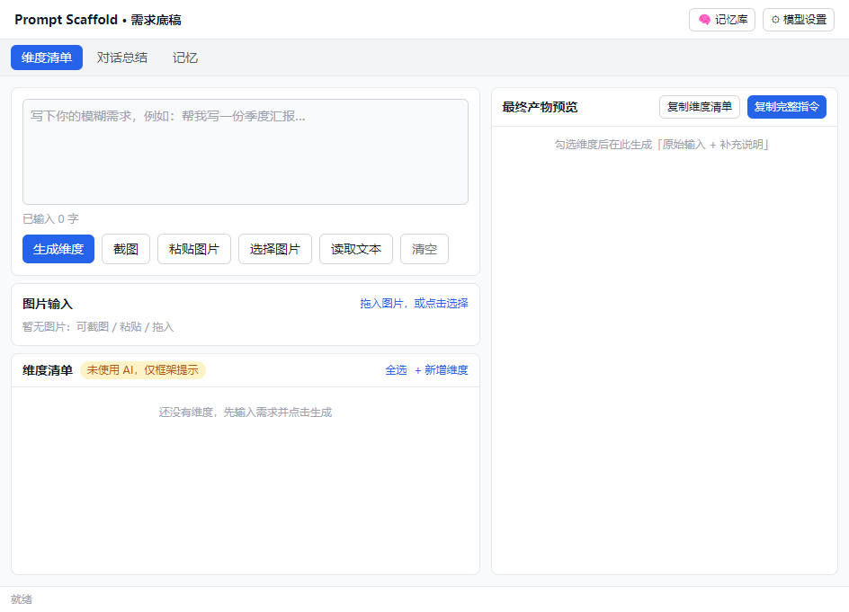

# Prompt Scaffold · 需求底稿 + 记忆记事本

> 不只是强化提示词，更是提醒你想到那些没想到的维度。
> 本地优先、隐私优先，AI 只是**默认关闭、可自选**的增强项。

**English: [README.md](./README.md)**

Prompt Scaffold 是一个本地运行的 Electron 桌面应用，由两个顶层模块组成：

| 模块 | 一句话 |
|---|---|
| **需求底稿（Prompt Scaffold）** | 输入模糊指令 → 补全你可能漏掉的维度清单（每条带可采纳措辞）→ 勾选后生成完整指令 |
| **记忆（记事本）** | 轻量 note-taking：记录、回看、资料、版本、搜索、备份，可选 AI 总结/提醒 |

核心哲学：**不替用户写、不替用户做决定**——它只产出**可勾选、可修改的原材料**，帮你想到那些没想到的维度，取舍权始终在你手里。



---

## ✨ 功能

### 需求底稿
- 独立小窗 + 托盘常驻
- 输入：文字 / 一键截图 / 粘贴剪贴板 / 拖入图片
- 维度清单生成（结构化 JSON，走真实大模型 API）
- 对话总结（粘贴多轮对话 → 核心诉求 + 补全维度）
- 分享链接抓取（公开分享页自动抓正文，失败可手动粘贴兜底）
- 模型用户自选 + key 自填（智谱 / DeepSeek / Ollama / 自定义）
- 图片走多模态视觉模型；不支持时引导换模型
- 规则 + 硬编码维度池兜底：无 key 时回退本地预置维度，**明确标注「未使用 AI」不冒充**

### 记忆（记事本）
- 记事条目 + 天/周/月回看 + 显式周期文件夹
- 资料仓库：文本/Markdown + PDF/Office 二进制（内容寻址去重 + 抽取文本搜索）
- 版本控制：历史快照 + 回滚 + 清理提醒（按版本数/空间/时间三维度，只建议不自动删）
- 全文搜索（MiniSearch，含资料抽取文本）
- 回收站软删除 + 导入导出 + 本地备份/恢复
- 记忆库：可视化 + 导入/导出（合并/覆盖 + 冲突校验 + 去重）

---

## 🔒 隐私优先

每个 AI 能力（输入增强 / 总结 / 提醒 / 代码执行）都**独立可配三档、默认关闭**：

| 档位 | 含义 | 数据流向 |
|---|---|---|
| 关闭 | 不调用任何模型 | 不出机 🟢 |
| 本地模型 | 本机推理（Ollama 等） | 不出机 🟢 |
| 外部模型 | 云端 LLM API（自备 key） | 出机 ☁️ |

「外部模型」档再叠加**发送范围**选择（全部 / 仅选中 + 字段级脱敏），并有**一键全关逃生舱**与**出机前二次确认**。数据默认只存本机，无自动采集、无埋点。

---

## 💻 跨平台（Windows / Linux / macOS）

代码跨平台规范、**零 native 编译依赖**（`npm install` 三平台只装纯 JS）。平台差异集中在 `src/shared/platform.ts` 穷尽分发，另有 `scripts/check-platform.mjs` 守卫脚本扫描违例。

- **Windows**：`npm run dist:win` → NSIS 安装包
- **macOS**：`npm run dist:mac` → dmg + zip（需在 macOS 上打包）
- **Linux**：`npm run dist:linux` → AppImage + deb

> 安装包打包受平台限制（mac 的 dmg 只能在 mac 上打）。项目内置 GitHub Actions 三平台流水线（`.github/workflows/build.yml`），推送到 GitHub 打 tag（`v*`）即可自动产出三平台安装包。

---

## 🚀 快速开始

```bash
npm install
npm run dev          # 开发模式
npm run typecheck    # 类型检查
npm test             # 单元测试
node scripts/check-platform.mjs   # 跨平台守卫
```

## 📦 构建打包

```bash
npm run build        # 构建主进程 + 渲染层
npm run dist:win     # Windows（NSIS）
npm run dist:mac     # macOS（dmg + zip）
npm run dist:linux   # Linux（AppImage + deb）
```

> 打包时若下载 Electron 失败，可设置镜像：`ELECTRON_MIRROR=https://npmmirror.com/mirrors/electron/`；NSIS 等工具链镜像：`ELECTRON_BUILDER_BINARIES_MIRROR=https://npmmirror.com/mirrors/electron-builder-binaries/`。

## 🛠 技术栈

Electron ^34 + electron-vite + electron-builder · React 18 + TypeScript + Tailwind · openai SDK（OpenAI 兼容协议）· JSON 文件存储（原子写）· MiniSearch · pdfjs-dist / mammoth / jszip（PDF/Office 抽取）。

## 📚 文档

- 产品规格：`docs/PRD-v5.md`
- 系统架构：`docs/ARCHITECTURE.md`、`docs/ARCHITECTURE-v2.md`
- 记忆工具架构：`docs/MEMORY-TOOL-ARCHITECTURE-v2.md`
- 三平台方案：`docs/CROSS-PLATFORM-PLAN.md`

## 📄 License

[MIT](./LICENSE) · 第三方依赖许可证见 [THIRD_PARTY_NOTICES.md](./THIRD_PARTY_NOTICES.md)
