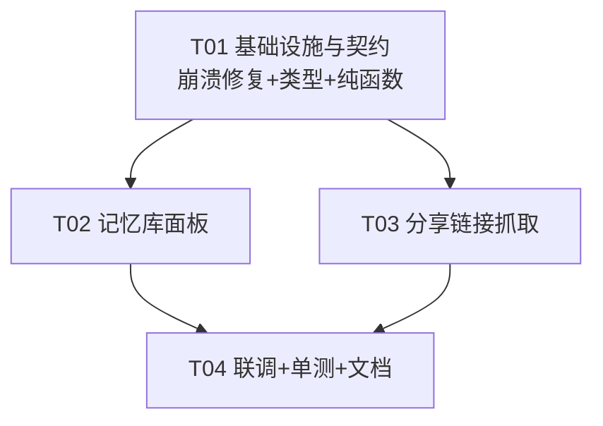
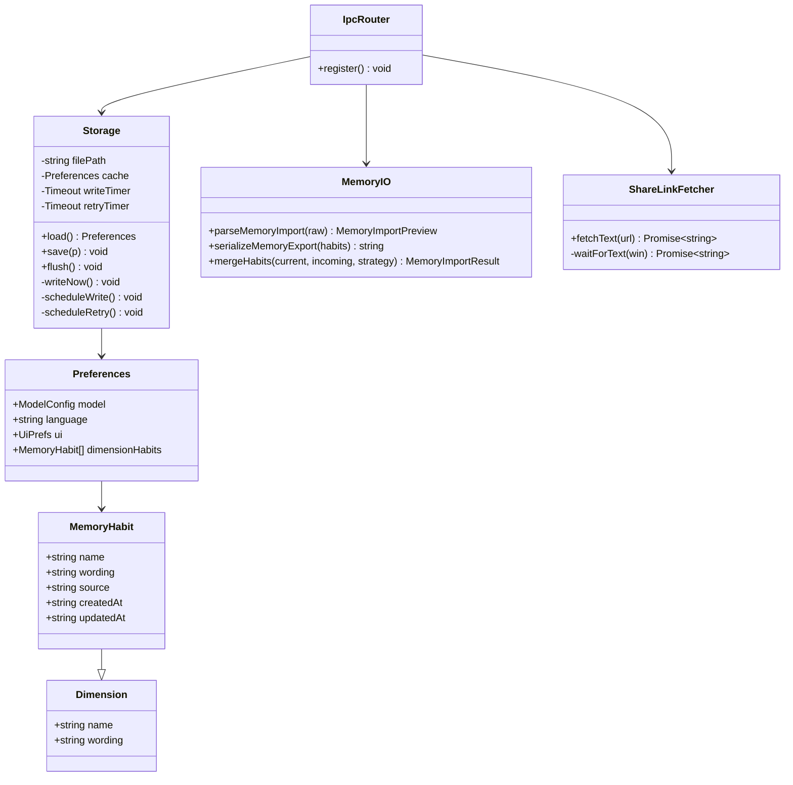
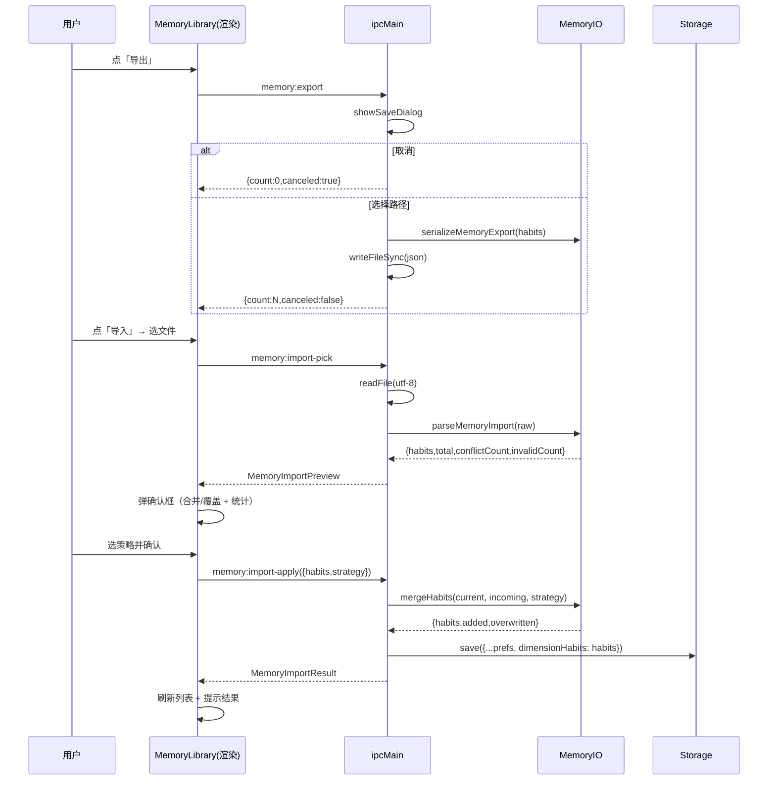
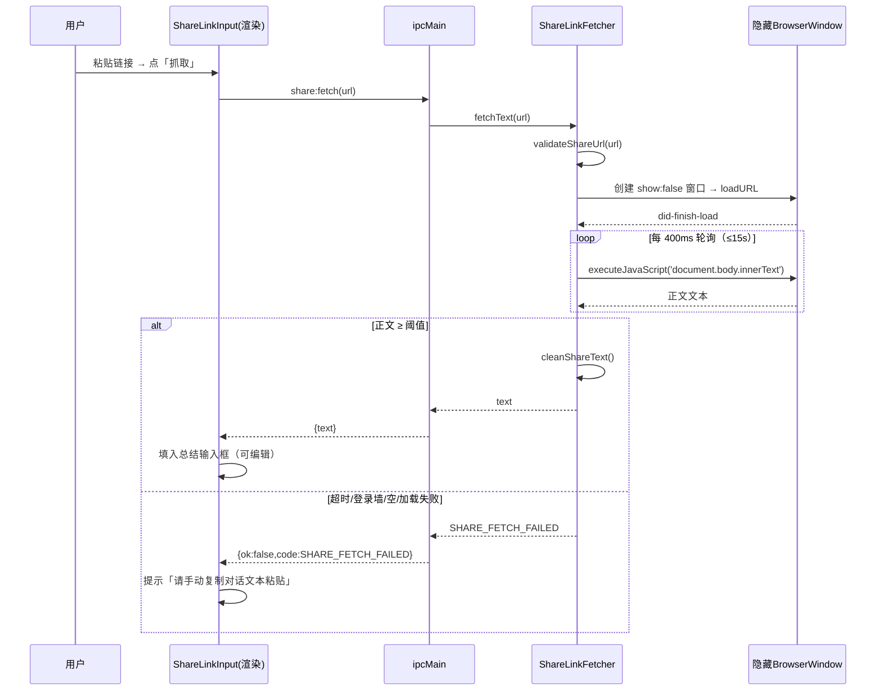

# 架构设计 v2 · Prompt Scaffold 增量（三个用户反馈问题）

> 本文档是 `ARCHITECTURE.md` 的**增量设计**，只覆盖首版交付后用户实测反馈的三个问题的修复/新功能，不改动既有架构基线。
>
> - 问题1（Bug）：写入 API key 时界面容易闪退 → 修复
> - 问题2（功能缺口）：看不到记忆库，要「导入/导出记忆库」工具 → 新功能
> - 问题3（方向问题）：对话总结应支持「分享链接」而非截图 → 新功能（务实 MVP）
>
> 依据代码 `src/**` 全量通读后给出。所有结论均落到「文件 / 函数 / 怎么改」，供工程师直接照做。

---

## 0. 结论速览（供转达）

| 问题 | 结论一句话 | 落点 |
|---|---|---|
| 问题1 闪退 | **根因：`store.ts` 的 `writeNow()` 在 `setTimeout` 回调里无 try-catch，Windows 下 `renameSync` 失败（EPERM/EACCES）变成主进程 uncaughtException → 主进程退出 → 窗口闪退** | 修复 `store.ts` + `index.ts` 全局兜底 |
| 问题2 记忆库 | 新增「记忆库」面板：可视化/单删/清空/导出 JSON/导入 JSON（合并·覆盖 + 冲突校验 + 去重）；数据模型升级为 `MemoryHabit`（含来源+时间戳），字段仍用 `dimensionHabits` 以最小迁移 | 新增 `MemoryLibrary.tsx` + 3 个 IPC + `memory-io.ts` |
| 问题3 分享链接 | **自动抓取通用性差**：多数分享页是 JS 渲染 SPA，纯 fetch 拿不到正文；厂商公开 API 基本没有。推荐「隐藏 BrowserWindow 尽力抓取 + 失败即提示手动粘贴」的**务实 MVP**，不承诺所有链接都能一键抓 | 新增 `share-fetch.ts` + 1 个 IPC + `ShareLinkInput.tsx` |

---

## 1. 问题1：写入 API key 闪退（修复）

### 1.1 根因结论（已逐条核实）

| 线索 | 核实结果 | 是否崩溃根因 |
|---|---|---|
| ① `store.ts` `writeNow()` 在 `scheduleWrite()` 的 `setTimeout` 回调里执行，回调体无 try-catch | **属实**。`savePrefs` 里 `storage.save(p)` 只做 `cache=p; scheduleWrite()` 后立即返回，300ms 后 `writeNow()` 在宏任务回调里跑，脱离 `ipc.ts` 的 try-catch | ✅ **是根因** |
| ② `llm.ts` `model.trim()` 空串 | **不会崩**。`.trim()` 对空串安全；空 model 传 OpenAI 走 `chat()` 的 try-catch → `mapError` → 返回 `fail`，只影响 UX 不影响主进程存活 | ❌ 非根因，顺手加固 |
| ③ `ModelSettings.tsx` effect 时序 | **无死循环/无未捕获 rejection**。`savePrefs` 走 `ipcRenderer.invoke`，恒 resolve；`useEffect([prefs,open])` 重设 draft 为 `prefs.model`，语言/主题变更不动 model，无循环 | ❌ 非根因 |
| ④ `ipc.ts` `savePrefs` 有 try-catch，`storage.save` 是异步防抖 | **属实，但正好是盲区**：try-catch 只包住同步的 `storage.save()`，包不住 300ms 后的定时器回调 | ✅ 佐证根因 |

**最终根因**：`src/main/storage/store.ts` 的 `writeNow()`（约 94–100 行）包含 `writeFileSync(tmp, …)` + `renameSync(tmp, filePath)`，被 `scheduleWrite()` 的 `setTimeout` 回调（约 88–91 行）调用，**回调体内没有 try-catch**。Windows 上目标文件被占用（杀软扫描 / 编辑器打开 / 两次写入竞争）时 `renameSync` 抛 `EPERM`/`EACCES`，成为主进程 `uncaughtException` → Electron 主进程退出 → 所有窗口关闭 = 「闪退」。保存 key 会触发 `scheduleWrite`，命中概率高，与「写入 api 时闪退」完全吻合。

### 1.2 修复方案（照做即可）

**改 1：`src/main/storage/store.ts` —— `writeNow()` 自守卫 + 降级 + 重试，绝不向定时器回调抛异常**

```ts
// 顶部 import 增补 unlinkSync
import { existsSync, readFileSync, writeFileSync, renameSync, unlinkSync, mkdirSync } from 'fs'
// constants 增补 STORAGE_RETRY_MS（见 §5）

// 类内新增重试定时器字段
private retryTimer: NodeJS.Timeout | null = null

// flush() 同步清两个定时器
flush(): void {
  if (this.writeTimer) { clearTimeout(this.writeTimer); this.writeTimer = null }
  if (this.retryTimer) { clearTimeout(this.retryTimer); this.retryTimer = null }
  if (this.cache) this.writeNow()
}

// 新增：写入失败后的单次重试（防抖 1s）
private scheduleRetry(): void {
  if (this.retryTimer) return
  this.retryTimer = setTimeout(() => {
    this.retryTimer = null
    this.writeNow()
  }, STORAGE_RETRY_MS)
}

// 重写 writeNow：全程 try-catch，失败不抛出
private writeNow(): void {
  if (!this.cache) return
  const payload = JSON.stringify(this.cache, null, 2)
  const tmp = this.filePath + '.tmp'
  try {
    mkdirSync(dirname(this.filePath), { recursive: true })
    writeFileSync(tmp, payload, 'utf-8')
    renameSync(tmp, this.filePath)
  } catch (err) {
    // 关键：定时器回调内绝不再抛（否则主进程 uncaughtException → 闪退）
    try {
      // 降级：rename 失败（目标被占用 / 文件系统不支持原子替换）→ 直接覆盖写
      writeFileSync(this.filePath, payload, 'utf-8')
      console.warn('[store] 原子替换失败，已降级为直接写入', errMsg(err))
    } catch (err2) {
      // 直接写也失败：保留内存缓存（数据仍在 this.cache，不丢），稍后重试
      console.error('[store] 落盘失败，保留内存缓存并重试', errMsg(err2))
      this.scheduleRetry()
    } finally {
      try { unlinkSync(tmp) } catch { /* 忽略残留 tmp 清理失败 */ }
    }
  }
}

// 文件底部新增脱敏错误格式化（不含 apiKey，仅 name/message）
function errMsg(err: unknown): string {
  if (err instanceof Error) return `${err.name}: ${err.message}`
  return String(err)
}
```

要点：
- **先写 tmp 再 rename 的原子性保留**；rename 失败才降级为直接写（仍可能失败，故再兜一层 try-catch）。
- 任何失败都**不再上抛**，内存缓存是最新数据，下次 `save`/`flush` 会重试，不丢数据、不崩进程。

**改 2：`src/main/index.ts` —— 主进程全局兜底（防御纵深）**

在 `app.whenReady()` 之前（`else` 分支内靠前处）加入：

```ts
// 兜底：任何漏网的定时器/异步异常都只记日志、保活，不让主进程闪退
process.on('uncaughtException', (err) => {
  console.error('[main] uncaughtException（已捕获，保持运行）', err)
})
process.on('unhandledRejection', (reason) => {
  console.error('[main] unhandledRejection（已捕获，保持运行）', reason)
})
```

说明：这是「双保险」。即使未来再有回调漏 try-catch，也只写日志不再退出整个应用。对本工具（本地小工具，无一致性敏感状态）比直接闪退更合理。日志已通过 `errMsg` 与 openai SDK 行为保证不含 apiKey（不额外打印 request body）。

**改 3（顺手加固，非根因）：`src/main/ai/llm.ts` —— 空 model 前置校验**

在 `generateDimensions()` 文本分支（约 86 行）与 `summarizeConversation()`（约 103 行）赋值 `this.currentModel` 前加：

```ts
if (!this.config.model?.trim()) {
  throw new AppError('MODEL_ERROR', '未配置文本模型名称（请到「模型设置」填写 model）')
}
```

（视觉分支 `generateDimensions` 已有 `visionModel` 空值校验，保持不动。）作用：把「空 model 导致的模型报错」变成一句人话，不影响崩溃修复。

---

## 2. 问题2：记忆库（导入/导出 + 可视化）

### 2.1 数据模型决策（结论 + 理由）

**结论：升级为独立结构 `MemoryHabit`（新增 `source` / `createdAt` / `updatedAt`），但存储字段沿用现有 `Preferences.dimensionHabits`（不新增 `memoryHabits` 字段），加载时自动迁移旧数据。**

```ts
export type MemoryHabitSource = 'ai-adopted' | 'imported' | 'manual' // manual 预留，MVP 不用

export interface MemoryHabit extends Dimension {  // 复用 name / wording
  source: MemoryHabitSource
  createdAt: string   // ISO 8601 UTC
  updatedAt: string
}

export interface Preferences {
  model: ModelConfig
  language: Language
  ui: UiPrefs
  dimensionHabits: MemoryHabit[]   // ← 由 Dimension[] 升级，字段名不变
}
```

理由：
1. 记忆库面板要展示「来源 / 时间」，**必须加字段**；沿用 `Dimension` 无法满足。
2. **字段名沿用 `dimensionHabits`**：改名成本高、收益低——`ipc.ts` 注入 prompt、`prompts.ts habitsBlock`、`useAppState.setHabit`、`memory.ts`、测试等大量引用此字段名。`MemoryHabit` 是 `Dimension` 的超集（结构多 3 个字段），`habitsBlock(habits: Dimension[])` 传 `MemoryHabit[]` 依然类型兼容，**prompt 注入零改动**。
3. **迁移零成本**：`load()` 里的 `dedupeHabits()` 升级为「归一化函数」，把旧 `{name,wording}` 补成完整 `MemoryHabit`（`source:'ai-adopted'`、时间戳取当前/文件时间），旧文件读入即升级，无需一次性迁移脚本。
4. **记忆写入原则不变**：维度措辞仍仅「AI 提议 + 用户采纳」写入（`source='ai-adopted'`）；导入属于用户显式操作，`source='imported'` 且**可覆盖同名**。

### 2.2 UI 交互（`MemoryLibrary.tsx` 弹窗）

- **入口**：主窗口 `header` 在 `ModelSettings` 旁新增「记忆库」按钮，点开弹窗（复用 ModelSettings 的遮罩弹窗样式）。
- **列表**：每条显示 `name`（加粗）、`wording`（次要文本）、来源徽标（`AI 采纳` / `导入`）、`updatedAt` 本地时间；右上角「删除」单条；底部「清空」二次确认。
- **空态**：「暂无记忆，可在维度清单里『设为习惯』或导入 JSON」。
- **导出**：按钮 → `dialog.showSaveDialog`（默认文件名 `prompt-scaffold-memory-YYYYMMDD.json`）→ 写入 → 提示「已导出 N 条」。
- **导入**：按钮 → `dialog.showOpenDialog`（filter json）→ 校验 + 返回预览 → 弹确认框展示「共 N 条 / 其中 M 条与现有同名冲突 / K 条非法被跳过」→ 用户二选一：
  - **合并**（默认）：同名维度以导入文件为准，新维度追加，未冲突的现有维度保留；
  - **覆盖**：清空现有 `dimensionHabits`，只保留导入内容（去重后）。
  - 确认后应用 → 刷新列表 + 提示结果（「新增 A 条 / 覆盖 B 条」）。

### 2.3 IPC 契约（新增 3 个 channel，写入 `ipc-contract.ts`）

```ts
// src/shared/ipc-contract.ts 新增
IPC = {
  ...,
  memoryExport: 'memory:export',          // 导出 JSON
  memoryImportPick: 'memory:import-pick',  // 选文件 + 解析 + 预览
  memoryImportApply: 'memory:import-apply' // 按策略合并/覆盖
}

interface RendererApi {
  ...,
  exportMemory(): Promise<IpcResult<MemoryExportResult>>
  pickMemoryImport(): Promise<IpcResult<MemoryImportPreview | null>>  // null=取消
  applyMemoryImport(args: MemoryImportApplyArgs): Promise<IpcResult<MemoryImportResult>>
}
```

```ts
// src/shared/types.ts 新增
export interface MemoryExportResult { count: number; canceled: boolean }
export interface MemoryImportPreview {
  fileName: string
  habits: MemoryHabit[]        // 归一化后的合法条目（源=imported）
  total: number                // 合法条数
  conflictCount: number        // 与现有 dimensionHabits 同名的条数
  invalidCount: number         // 被跳过的非法条数
}
export type MemoryImportStrategy = 'merge' | 'overwrite'
export interface MemoryImportApplyArgs { habits: MemoryHabit[]; strategy: MemoryImportStrategy }
export interface MemoryImportResult { habits: MemoryHabit[]; added: number; overwritten: number }
```

### 2.4 导入/导出/冲突/校验逻辑（纯函数放 `memory-io.ts`，可单测）

**导出 JSON 格式（version 化）**：
```json
{
  "version": 1,
  "exportedAt": "2026-11-05T12:00:00.000Z",
  "habits": [
    { "name": "篇幅", "wording": "800字以内", "source": "ai-adopted", "createdAt": "…", "updatedAt": "…" }
  ]
}
```

**校验（`parseMemoryImport(raw: string): { habits: MemoryHabit[]; invalidCount: number }`）**：
1. `JSON.parse` 失败 → 抛 `IMPORT_INVALID`（「文件不是合法 JSON」）。
2. 接受三种结构：`{habits:[…]}`（本格式）/ `{dimensionHabits:[…]}`（旧格式）/ 裸数组，任一命中即可，否则 `IMPORT_INVALID`。
3. 逐条归一化：`name` trim 后为空 → `invalidCount++` 跳过；`wording` 缺失默认 `''`；`source` 缺失/非法 → `'imported'`；`createdAt/updatedAt` 缺失/非法 → `nowIso()`。
4. 归一化后 `habits.length === 0` → 抛 `IMPORT_INVALID`（「没有可导入的有效条目」）。

**冲突 + 合并（`mergeHabits(current, incoming, strategy)`）**：
- 先 `dedupeHabits` 去重（按 `name` 精确匹配，首条生效）。
- `overwrite`：返回 `dedupeHabits(incoming)`。
- `merge`：从 `current` 出发，对每条 incoming——同名 → 覆盖该条（`updatedAt=now`，`source='imported'`，`createdAt` 保留 incoming 自带或沿用原条）；不同名 → 追加；统计 `overwritten` / `added`。

**单条删除 / 清空**：不新增 IPC，复用现有 `savePrefs`——渲染层在 `MemoryLibrary` 里用 `savePrefs({...prefs, dimensionHabits: filteredOrEmpty})` 直接持久化（与现有 `setHabit` 同一路径）。

---

## 3. 问题3：对话总结支持「分享链接」

### 3.1 技术可行性结论（评估 4 个候选）

| 方案 | 结论 | 说明 |
|---|---|---|
| a. 隐藏 `BrowserWindow` 加载→等待渲染→抓 DOM 文本 | ✅ **推荐（尽力抓取）** | 可行。`webContents.executeJavaScript` 属特权注入，**不受页面 CSP 限制**；真正的拦路虎是「登录墙 / 人机验证 / 反爬」，不是 CSP |
| b. 各厂商公开 API / 结构化数据 | ❌ 基本不可行 | ChatGPT/Claude/DeepSeek/智谱/Kimi 分享页**均无稳定公开只读 API**；内嵌的 `__NEXT_DATA__` 等结构各厂各异且随时变，维护成本极高 |
| c. 失败后仍可手动粘贴文本兜底 | ✅ **必须保留** | 现有「粘贴/拖入 .txt/.md」不动，作为兜底 |
| d. 更优方案 | 无 | 首版不上 Puppeteer/Playwright（额外 Chromium 体积 + 安装复杂度）；纯 Electron 隐藏窗口已够用 |

**总体判断**：**通用自动抓取成本高、稳定性差，不应承诺「所有链接一键抓」**。务实做法 = 方案 a（尽力抓） + 方案 c（失败兜底）打包成 MVP，并对用户诚实告知边界。

**哪些链接能自动抓 / 哪些不行（给用户的预期）**：
- ✅ 通常可抓：**公开、免登录、无验证码**的分享页（多厂商「分享链接」正属此类，例如 Kimi、部分 ChatGPT/Claude 公开分享）。
- ❌ 通常抓不到（会触发兜底）：**需登录才能查看**、**含人机验证/Cloudflare 防护**、**强制跳转 OAuth** 的链接。
- 结论呈现给用户的话术：「自动抓取为尽力而为；失败时会提示你手动复制对话文本粘贴」。

### 3.2 推荐方案与 MVP 边界

**MVP 输入交互**（`ShareLinkInput.tsx`，仅 summary 模式显示）：
```
[ 粘贴分享链接…                  ] [抓取]
 · 抓取中：spinner「正在打开链接并等待渲染…」
 · 成功：文本填入总结输入框（可编辑，再点「生成总结」）
 · 失败：红色提示「自动抓取失败（可能需登录或含验证码），请手动复制对话文本粘贴到下方输入框」
```
- 成功后**替换**总结输入框文本（用户要总结的就是这条对话）；若输入框已有内容则追加分隔线（与现有 `readTextFile` 行为一致，更稳妥）。
- 保留原「粘贴文本 / 拖入 .txt/.md」入口不动。

**技术实现路径**（`src/main/share-fetch.ts`）：

```ts
export class ShareLinkFetcher {
  async fetchText(url: string): Promise<string> {
    validateShareUrl(url)          // 仅 http/https，否则 SHARE_FETCH_FAILED
    const win = new BrowserWindow({
      show: false,
      webPreferences: { sandbox: true, contextIsolation: true, nodeIntegration: false }
    })
    try {
      // 降低被识别为无头：伪装桌面 Chrome UA；拒绝不必要的权限
      win.webContents.session.setPermissionRequestHandler((_wc, _p, cb) => cb(false))
      await win.loadURL(url, { userAgent: DESKTOP_CHROME_UA })
      const text = await this.waitForText(win)   // did-finish-load + 轮询 + 超时
      if (cleanShareText(text).length < SHARE_FETCH_MIN_TEXT_CHARS) throw new Error('EMPTY')
      return cleanShareText(text)
    } finally {
      if (!win.isDestroyed()) win.destroy()
    }
  }
}
```

- **等待策略**：`did-finish-load` 后每 `SHARE_FETCH_POLL_MS=400ms` 执行 `executeJavaScript('document.body ? document.body.innerText : ""')` 轮询，最多 `SHARE_FETCH_TIMEOUT_MS=15000ms`；满足「正文长度 ≥ `SHARE_FETCH_MIN_TEXT_CHARS=120` 且相邻两次长度增长 <20%」即认为渲染完成；超时则返回已抓到的内容（不足阈值判失败）。
- **提取**：取 `document.body.innerText`，`cleanShareText()` 做轻量去噪（压缩多余空行、去除超短导航行）。**不写各厂专用选择器**——通用启发式，容忍少量导航噪声（后续交给总结模型+用户可编辑）。
- **兜底**：`loadURL` 抛错 / 超时 / 正文为空 / 检测到登录墙（正文短且含「登录/Log in/Sign in」关键词）→ 统一抛 `SHARE_FETCH_FAILED`，渲染层给「手动粘贴」提示。

### 3.3 IPC 契约（新增 1 个 channel）

```ts
IPC = { ..., shareFetch: 'share:fetch' }
interface RendererApi { ..., fetchShare(url: string): Promise<IpcResult<{ text: string }>> }
```

---

## 4. 新增 / 修改文件清单（相对 `prompt-scaffold-app/`）

**新增**
```
src/shared/memory-io.ts                # 导入解析/校验 + 导出序列化 + mergeHabits（纯函数）
src/main/share-fetch.ts                # ShareLinkFetcher + validateShareUrl/cleanShareText（纯函数可测）
src/renderer/components/MemoryLibrary.tsx   # 记忆库弹窗（列表/删除/清空/导入/导出）
src/renderer/components/ShareLinkInput.tsx  # 分享链接输入 + 抓取态 + 失败兜底
tests/memory-io.test.ts                # 导入校验/合并/导出往返
tests/share-fetch.test.ts              # URL 校验 + 文本去噪（不启动 BrowserWindow）
```

**修改**
```
src/main/storage/store.ts              # writeNow 自守卫+降级+重试（问题1）
src/main/index.ts                      # uncaughtException/unhandledRejection 兜底（问题1）
src/main/ai/llm.ts                     # 空 model 前置校验（问题1 加固）
src/shared/types.ts                    # MemoryHabit + 导入导出类型 + ErrorCode 扩展
src/shared/constants.ts                # STORAGE_RETRY_MS / MEMORY_EXPORT_VERSION / SHARE_* 常量
src/shared/ipc-contract.ts             # 4 个新 channel + RendererApi 扩展
src/shared/memory.ts                   # adopt/dedupe 升级为 MemoryHabit，接入 mergeHabits
src/main/ipc.ts                        # 4 个新 handler（memory×3 + share×1）
src/preload/index.ts                   # 暴露 exportMemory/pickMemoryImport/applyMemoryImport/fetchShare
src/renderer/App.tsx                   # header 加「记忆库」入口
src/renderer/components/InputPanel.tsx # summary 模式嵌入 ShareLinkInput
src/renderer/i18n/zh.ts / en.ts        # 记忆库 + 分享链接文案 + 新错误码文案
tests/qa-store.test.ts                 # 增补：写失败不抛 / 降级路径
tests/memory.test.ts                   # 增补：MemoryHabit 迁移 / merge 冲突策略
README.md                              # 用法更新（记忆库 + 分享链接）
```

## 5. 新增依赖包

**无。** 全部走 Electron 内置 API（`BrowserWindow` / `executeJavaScript` / `dialog` / `fs`），保持「零 native 依赖」约束。`openai` 等既有依赖不变。

## 6. 新增 IPC channel（写入 `ipc-contract.ts`）

| channel 常量 | 值 | 说明 |
|---|---|---|
| `memoryExport` | `memory:export` | 导出记忆库 JSON |
| `memoryImportPick` | `memory:import-pick` | 选文件+解析+预览（返回 `MemoryImportPreview \| null`） |
| `memoryImportApply` | `memory:import-apply` | 按 `merge/overwrite` 应用导入 |
| `shareFetch` | `share:fetch` | 抓取分享链接正文 |

新增 `ErrorCode`：`IMPORT_INVALID` / `EXPORT_FAILED` / `SHARE_FETCH_FAILED`。
新增常量：`STORAGE_RETRY_MS=1000`、`MEMORY_EXPORT_VERSION=1`、`SHARE_FETCH_TIMEOUT_MS=15000`、`SHARE_FETCH_POLL_MS=400`、`SHARE_FETCH_MIN_TEXT_CHARS=120`。

## 7. 增量任务列表（有序，含依赖）

> 约束：≤5 任务；首任务为「基础设施/契约」；任务尽量只依赖 T01。

| 任务 | 名称 | 源文件 | 依赖 | 优先级 | 性质 |
|---|---|---|---|---|---|
| **T01** | 基础设施与契约：崩溃修复 + 类型/常量/契约/纯函数 | `src/main/storage/store.ts`、`src/main/index.ts`、`src/main/ai/llm.ts`、`src/shared/types.ts`、`src/shared/constants.ts`、`src/shared/ipc-contract.ts`、`src/shared/memory.ts`、`src/shared/memory-io.ts` | — | P0 | 修复 + 地基 |
| **T02** | 记忆库面板（导入/导出/可视化/删除/清空） | `src/main/ipc.ts`、`src/preload/index.ts`、`src/renderer/components/MemoryLibrary.tsx`、`src/renderer/App.tsx`、`src/renderer/i18n/zh.ts`、`src/renderer/i18n/en.ts` | T01 | P1 | 新功能 |
| **T03** | 分享链接抓取（隐藏窗口 + UI + 兜底） | `src/main/share-fetch.ts`、`src/main/ipc.ts`、`src/preload/index.ts`、`src/renderer/components/ShareLinkInput.tsx`、`src/renderer/components/InputPanel.tsx`、`src/renderer/i18n/zh.ts`、`src/renderer/i18n/en.ts` | T01 | P1 | 新功能 |
| **T04** | 联调 + 单测 + 文档 | `tests/qa-store.test.ts`、`tests/memory.test.ts`、`tests/memory-io.test.ts`、`tests/share-fetch.test.ts`、`README.md`、`docs/ARCHITECTURE-v2.md` | T02, T03 | P1 | 收尾 |

**并行/顺序说明**：
- T02、T03 只依赖 T01，可由同一工程师顺序做（推荐：先 T02 后 T03，减少 `ipc.ts`/`preload`/i18n 同一文件的手工合并）；若并行，二者对 `ipc.ts`、`preload/index.ts`、`zh.ts`、`en.ts` 的改动均为**追加**（新 handler / 新方法 / 新 key），冲突面小，合并时保留双方新增即可。

### 任务依赖图



## 8. 类图（增量）



## 9. 时序图（增量）

### 9.1 记忆库：导出 + 导入（含冲突）



### 9.2 分享链接抓取（尽力 + 兜底）



## 10. 共享知识（增量约定，追加到 ARCHITECTURE.md §10）

1. **定时器/异步回调内禁止裸抛**：任何 `setTimeout`/`setInterval`/Promise 回调里涉及 fs/网络的操作必须 try-catch；主进程 `uncaughtException`/`unhandledRejection` 已兜底（只记日志、保活）。
2. **存储写入降级链**：tmp 原子写 → rename 失败降级直接写 → 仍失败保留内存缓存 + 1s 单次重试；`flush()` 同步清 write/retry 两个定时器。
3. **记忆数据模型**：`dimensionHabits: MemoryHabit[]`（source ∈ `ai-adopted|imported|manual`，时间 ISO 8601 UTC）；旧 `{name,wording}` 在 `dedupeHabits` 归一化时自动升级为 `ai-adopted`。
4. **记忆写入原则不变**：维度措辞仍仅「AI 提议 + 用户采纳」写入；导入是用户显式操作，`merge`（同名导入覆盖）/`overwrite`（整体替换）均可覆盖。
5. **导入/导出契约**：导出 `{version:1, exportedAt, habits:[…]}`；导入兼容 `{habits}` / `{dimensionHabits}` / 裸数组，非法条目计数跳过，全非法报 `IMPORT_INVALID`。
6. **分享链接边界**：自动抓取是「尽力而为」，不承诺通用；失败必须给出「手动粘贴」兜底提示，不得让用户误以为所有链接都能一键抓。
7. **IPC 唯一来源不变**：4 个新 channel 与签名一律走 `ipc-contract.ts`，preload/main 双向引用。

## 11. 风险点（增量）

| # | 风险 | 影响 | 缓解 |
|---|---|---|---|
| 1 | 分享页登录墙/验证码/反爬 | 自动抓取失败率高 | 明确兜底「手动粘贴」；首版不承诺成功率；后续可按厂商加白名单选择器 |
| 2 | 隐藏窗口抓取可能触发厂商风控 | 极少数情况账号异常 | 使用独立 `session` 拒绝权限、伪装桌面 UA；文档明示「相当于用内置浏览器打开该链接」 |
| 3 | 导入非法/超大 JSON | 卡顿/内存 | 先 `JSON.parse` 失败即报错；限制文件大小（如 ≤5MB）与条数（如 ≤1000） |
| 4 | `MemoryHabit` 迁移对旧数据 | 旧字段丢失 | `dedupeHabits` 归一化 + 保留 `name/wording`，仅新增字段 |
| 5 | 写失败重试仍失败 | 偏好未持久化（内存仍最新） | 退出前 `flush` 兜底；失败仅日志，不崩；下次启动 `load` 读旧文件（最坏回退上次成功值） |
| 6 | `uncaughtException` 兜底掩盖真实 bug | 长期静默 | 日志打全；仅作为最后防线，主路径仍靠 T01 的 try-catch 修复 |

---

*文档完 · 架构师 高见远（v2 增量）*
