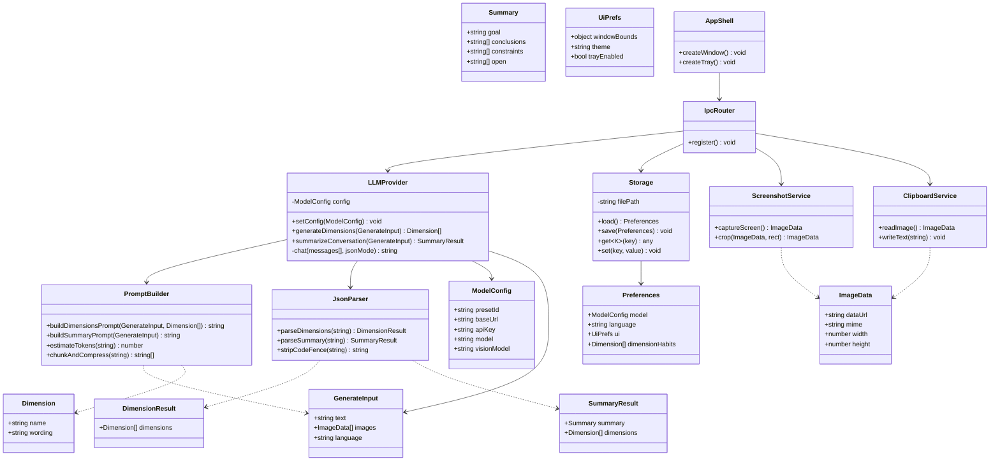
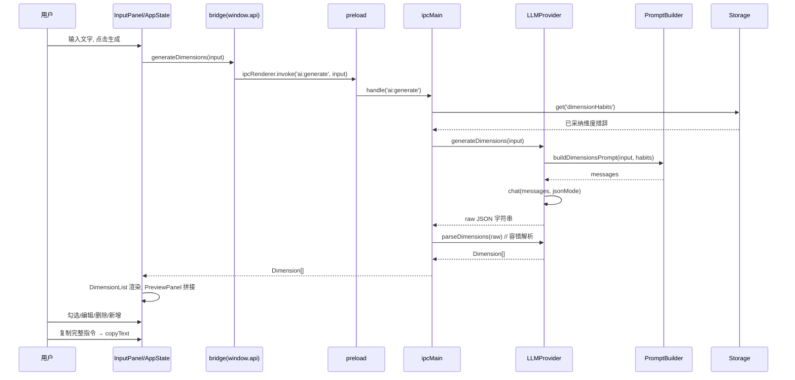
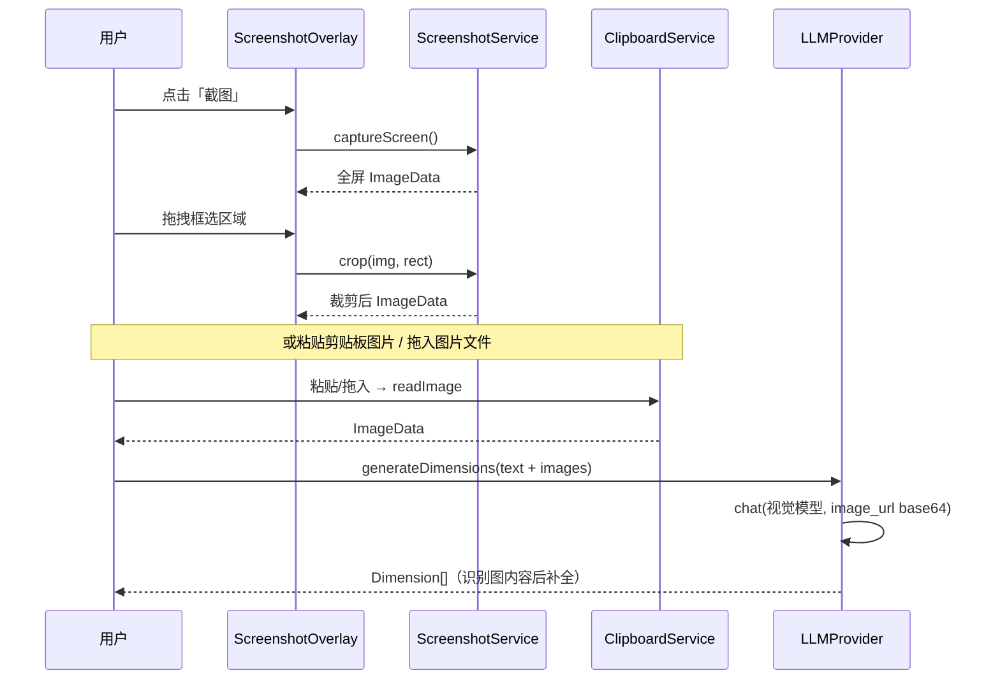
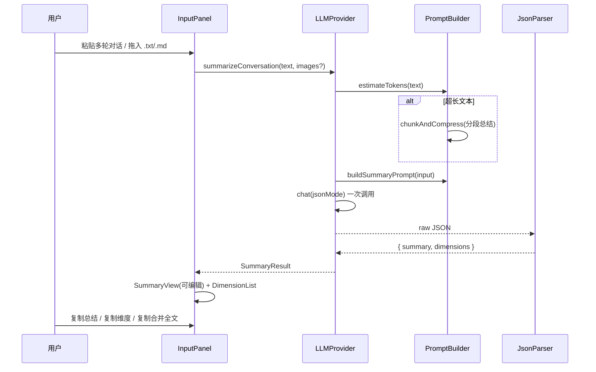
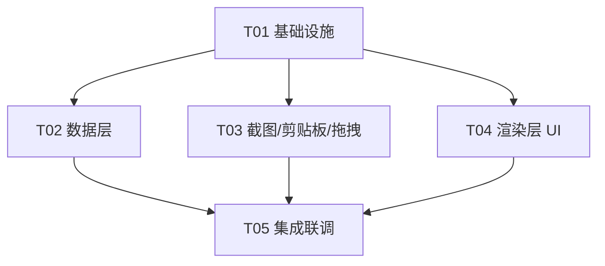

# 架构设计 · Prompt Scaffold（独立桌面版）

> 依据 PRD v4 定稿。本文档给出：**技术可行性结论 → 技术选型 → 系统架构 → 文件列表 → 数据结构与接口 → 调用流程 → 任务分解 → 依赖清单 → 共享知识 → 风险点**。

---

## 0. 本机环境实测结果（可行性基线）

> 已实际跑命令验证，非假设。

| 检查项 | 命令 | 结果 | 结论 |
|---|---|---|---|
| Node.js | `node --version` | **v22.22.2** ✅ | 满足 Electron 要求（≥20） |
| npm | `npm --version` | **10.9.7** ✅ | 正常 |
| npm 源连通 | `npm ping` | **PONG 1387ms** ✅ | 可正常拉包 |
| Rust 工具链 | `rustc` / `cargo` / `rustup` | **均不存在** ❌ | Tauri 硬门槛缺失 |
| MSVC 构建工具 | `C:\Program Files (x86)\Microsoft Visual Studio` | 仅 `Installer`，**无 VS2022/编译器** ❌ | 原生模块编译缺 linker |
| Windows SDK | `C:\Program Files (x86)\Windows Kits` | 仅 `8.1`（陈旧） ⚠️ | 不足以支撑 Rust/MSVC 链接 |
| 包管理器 | `choco` / `winget` / `scoop` | **均不存在** ❌ | 自动化安装工具链困难 |
| 操作系统 | Win32_OperatingSystem | **Windows 11 家庭版**（build 26300，x64） | 首版仅 Windows，符合 PRD |
| Python | `python --version` | 3.13.14 ✅ | 与交付无关（备选 OCR 可用） |

**关键判断**：本机 **Node 全链路就绪、网络可达**；但 **Rust + MSVC 构建工具链完全缺失**，且无 winget/choco/scoop 可便捷补齐。这直接决定了桌面框架选型（见 §1）。

---

## 1. 技术可行性结论（逐项）

### 1.1 桌面框架选型：Electron vs Tauri —— **结论：Electron（可行，推荐）**

| 维度 | Electron | Tauri |
|---|---|---|
| 本机就绪度 | ✅ Node v22 已装，`npm i` 即用 | ❌ 需先装 rustup + MSVC Build Tools（约 6–8GB），本机均缺失 |
| 原生编译需求 | ✅ 无（预编译二进制） | ❌ 需编译 Rust + 链接 C++，缺 MSVC linker 会失败 |
| 安装风险 | ✅ 低（纯 npm，网络已验通） | ❌ 高（无包管理器，手装工具链不确定性强） |
| 体积 / 内存 | ⚠️ 较大（安装包 ~150MB，运行 ~300MB） | ✅ 小（~10–20MB，内存低） |
| 生态成熟度 | ✅ 托盘/截图/剪贴板/拖拽全部有官方 API | ⚠️ 部分需 Rust crate + 平台差异适配 |
| 首版（仅 Windows）开发效率 | ✅ 高 | ⚠️ 需额外踩 Windows 工具链坑 |

**结论：本机环境下 Electron 可直接落地，Tauri 需先完成约 8GB 工具链安装且无自动化通道、失败风险高。首版选 Electron；轻量化诉求（体积/内存）记入「风险点」，后续若用户愿意补装 Rust 工具链可平滑迁移到 Tauri（前端代码可复用）。**

### 1.2 多模态视觉模型接入 —— **结论：可行**

- OpenAI 兼容协议对图片输入已形成事实标准：`messages[].content` 数组内 `{type:"image_url", image_url:{url:"data:image/png;base64,<...>"}}`。
- 智谱 `glm-4v-flash`、通义 `qwen-vl`（DashScope OpenAI 兼容端点）、OpenAI `gpt-4o`、Ollama（`/v1/chat/completions`）均支持该形态；差异仅在个别厂商（如 Ollama 旧版需 `images` 数组、部分厂商对 data URI 大小/格式有要求）。
- **统一适配策略**：`LLMProvider` 归一化层统一输出 `image_url` base64 data URI；针对厂商差异在 provider 内做字段映射兜底；不支持视觉时捕获报错并引导用户切换视觉模型（符合 PRD 降级策略）。
- **兜底**：视觉模型不可用时，可本地 OCR（`tesseract.js`，纯 WASM，无 native 编译）→ 文本模型，标注"已按文字识别处理"（P1 可选）。

### 1.3 内置屏幕截图 —— **结论：可行**

- 实现路径：Electron `desktopCapturer.getSources({types:['screen']})` 抓取全屏画面 → 打开全屏透明遮罩窗口展示缩略图 → 用户拖拽框选 → 按选区裁剪（`NativeImage.crop`）→ 输出 base64。全程纯 JS/官方 API，**无需 native 模块**，规避本机无 MSVC 的编译风险。
- 备选：Win32 系统截图 API 需 native addon（`node-ffi`/N-API），本机缺 MSVC，**不推荐**。

### 1.4 剪贴板图片读取 + 拖拽文件读取 —— **结论：可行**

- 剪贴板：Electron `clipboard.readImage()`（主进程/渲染进程均可）返回 `NativeImage` → `toDataURL()`。粘贴事件（`paste`）+ 主进程轮询双保险。
- 拖拽：HTML5 拖放读 `File` → `FileReader` → dataURL；主进程 `webContents` 也可拿到 `file.path`。文本文件（.txt/.md）走 `fs.readFile` 读入。均无 native 依赖。

### 1.5 本地存储（记忆层四类偏好 + 配置）—— **结论：JSON 文件（可行，推荐）**

| 方案 | 结论 | 理由 |
|---|---|---|
| **JSON 文件（原子写）** | ✅ **推荐** | 数据量极小（四类偏好 + 配置 + 少量维度措辞），纯 Node `fs` 实现，零依赖零编译，完全规避本机无 MSVC 的 native 风险 |
| SQLite（better-sqlite3） | ⚠️ 有风险 | 需编译/下载 native 绑定，本机缺 MSVC，失败概率高；且数据量用不上关系型能力 |
| electron-store | ⚠️ 可选 | 纯 JS 可用，但 v10 起 ESM-only，与 Electron 主进程 CJS 存在配置摩擦 |

落地：`app.getPath('userData')/preferences.json`，写入用"临时文件 + rename"保证原子性，内存缓存 + 防抖落盘。

### 1.6 长对话文本处理 —— **结论：可行**

- 本地按字符数粗估 token（中文 ~1.5 字/token，英文 ~4 字/token）做上下文预算。
- 超预算策略（三级，逐级启用）：
  1. **截断 + 保留头尾**：对超长文本保留开头（诉求/背景）与结尾（最新结论），中段摘要化。
  2. **分段总结（map-reduce）**：按固定窗口切块 → 逐块压缩 → 合并二次总结。
  3. **输入硬上限提示**：超出某阈值（如 64K 字符）直接提示用户，避免无意义等待。
- 全部纯 JS，无风险。拖入 .txt/.md 直接 `fs.readFile`。

### 1.7 托盘常驻 —— **结论：可行**

- Electron `Tray` 官方 API：托盘图标 + 右键菜单（显示主窗口 / 隐藏 / 退出）。
- 关闭窗口时 `window.on('close')` → `preventDefault()` + `hide()`（非退出），托盘点击唤起。
- 手动启动默认（双击图标即开）；开机自启列为 P2（后续用 `app.setLoginItemSettings`，Windows 下可行，本次不实现）。

---

## 2. 整体可行性判断

| 结论 | 说明 |
|---|---|
| ✅ **整体可行，无阻断性风险** | 全部 7 项关键技术点在本机环境均有纯 JS/官方 API 落地路径，**零 native 编译依赖** |
| ⚠️ 唯一环境依赖 | 仅"轻量化（Tauri）"诉求受限于本机缺 Rust/MSVC 工具链；**不影响首版交付**，Electron 已兜底 |
| 🎯 可 100% 落地的能力 | 独立小窗、文字/图片输入、OpenAI 兼容接入（文本+视觉）、维度清单+对话总结、四类偏好记忆、托盘常驻、一键复制 |
| 🟡 有条件落地（P1 可选） | OCR 兜底（tesseract.js 纯 WASM，可行）、开机自启（P2） |

---

## 3. 技术选型（最终基线）

| 层 | 选型 | 版本（建议） | 理由 |
|---|---|---|---|
| 桌面框架 | **Electron** | ^34（最新稳定） | 见 §1.1 |
| 构建/打包 | **electron-vite** + **electron-builder** | ^3 / ^25 | 一体化 TS+React+主进程构建，Windows 打包 |
| 渲染层 UI | **React 18 + TypeScript** | react ^18.3 / ts ^5.6 | 组件化，状态与交互清晰 |
| 样式 | **Tailwind CSS** | ^3.4 | 轻量，小窗 UI 快速成型（不用 MUI，减体积） |
| AI 客户端 | **openai SDK**（可配 `baseURL`） | ^4.71 | 官方兼容层，自带超时/重试/JSON mode；备选裸 `fetch` |
| 进程通信 | Electron **IPC**（contextBridge + invoke/handle） | 内置 | 类型安全契约见 §5 |
| 本地存储 | **JSON 文件 + 原子写**（自研薄封装） | 内置 `fs` | 见 §1.5 |
| 截图 | **desktopCapturer + 自绘选区** | 内置 | 见 §1.3 |
| 剪贴板/拖拽 | Electron `clipboard` / HTML5 DnD | 内置 | 见 §1.4 |
| 托盘 | Electron `Tray` | 内置 | 见 §1.7 |
| i18n | 自研轻量字典（zh/en） | 自研 | 两语言无需重库 |
| OCR 兜底（P1 可选） | tesseract.js | ^5 | 纯 WASM，无 native |

---

## 4. 系统架构

### 4.1 进程与模块划分

```
┌─────────────────────────────────────────────────────────────┐
│                      Main Process (Node)                     │
│  ┌──────────┐  ┌──────────┐  ┌───────────┐  ┌────────────┐  │
│  │ window.ts│  │  tray.ts │  │   ipc.ts  │  │  screenshot│  │
│  │ 主窗口   │  │ 托盘常驻 │  │ IPC 路由   │  │ .ts 截图   │  │
│  └──────────┘  └──────────┘  └─────┬─────┘  └─────┬──────┘  │
│        │              │            │              │          │
│  ┌─────┴──────────────┴────────────┴──────────────┴───────┐  │
│  │  ai/llm.ts(LLMProvider)  ai/prompts.ts  ai/parse.ts    │  │
│  │  storage/store.ts(JSON)  clipboard.ts                  │  │
│  └────────────────────────────────────────────────────────┘  │
└─────────────────────────────────────────────────────────────┘
                │ contextBridge (preload/index.ts)  类型安全契约
┌─────────────────────────────────────────────────────────────┐
│                   Renderer Process (React)                    │
│  App.tsx ── state/AppContext ── api/bridge.ts ── components/  │
│  ModeTabs | InputPanel | ImagePanel | DimensionList           │
│  SummaryView | PreviewPanel | ModelSettings | StatusBar        │
│  ScreenshotOverlay | i18n(zh/en)                               │
└─────────────────────────────────────────────────────────────┘
```

### 4.2 数据流（三大主链路）

**链路 A：文字输入 → 生成维度**
```
InputPanel(文字) → AppState → bridge.ai.generateDimensions()
  → ipcMain → LLMProvider.generateDimensions(text)
    → PromptBuilder.dimensions(text, 记忆维度措辞)
      → openai.chat.completions(baseURL/apiKey/model, response_format json)
        → JsonParser.parseDimensions(容错剥代码块) → Dimension[]
  ← 返回 → DimensionList 渲染（勾选/编辑/删除/新增）
  → PreviewPanel 实时拼接 → 复制完整指令(clipboard.writeText)
```

**链路 B：截图识图**
```
一键截图 → desktopCapturer.getSources → ScreenshotOverlay(全屏遮罩框选)
  → crop → base64(ImageData)
粘贴图片 → clipboard.readImage → dataURL
拖入图片 → File → dataURL
  → ImagePanel 显示缩略图 → 附带用户文字
  → bridge.ai.generateDimensions(text, images[]) → LLMProvider(视觉模型)
    → 图片以 image_url 传入 content 数组 → 识别 → 维度
```

**链路 C：对话总结**
```
InputPanel(粘贴多轮对话 / 拖入 .txt/.md) + 可选图片
  → bridge.ai.summarizeConversation(text, images)
    → LLMProvider.summarize(text, images)
      → PromptBuilder.summary(...) → 单次调用返回 {summary, dimensions}
        → 超长文本先走分段总结(§1.6)
      → JsonParser.parseSummary → { summary, dimensions }
  → SummaryView(可编辑) + DimensionList
  → 复制对话总结 / 复制维度清单 / 复制合并全文
```

---

## 5. 文件列表（相对路径，均在 `prompt-scaffold-app/` 下）

```
prompt-scaffold-app/
├── package.json
├── electron.vite.config.ts
├── electron-builder.yml
├── tsconfig.json
├── tsconfig.node.json
├── tsconfig.web.json
├── tailwind.config.js
├── postcss.config.js
├── .gitignore
├── README.md
├── resources/
│   ├── icon.png              # 应用图标（占位）
│   └── tray-icon.png         # 托盘图标（占位）
├── docs/
│   ├── PRD-v4.md
│   └── ARCHITECTURE.md
└── src/
    ├── shared/
    │   ├── types.ts          # 跨进程数据类型
    │   ├── constants.ts      # 预设、channel 名、限制常量
    │   └── ipc-contract.ts   # IPC 方法名与签名（类型安全）
    ├── main/
    │   ├── index.ts          # app 生命周期入口
    │   ├── window.ts         # 主窗口创建/显隐
    │   ├── tray.ts           # 托盘常驻
    │   ├── ipc.ts            # IPC handler 路由
    │   ├── screenshot.ts     # desktopCapturer 截图 + 裁剪
    │   ├── clipboard.ts      # 剪贴板图片读取
    │   ├── ai/
    │   │   ├── llm.ts        # LLMProvider（OpenAI 兼容客户端）
    │   │   ├── prompts.ts    # Prompt 模板 + 上下文注入
    │   │   └── parse.ts      # 容错 JSON 解析
    │   └── storage/
    │       └── store.ts      # JSON 原子写存储
    ├── preload/
    │   └── index.ts          # contextBridge 暴露安全 API
    └── renderer/
        ├── index.html
        ├── main.tsx
        ├── App.tsx
        ├── styles/global.css
        ├── api/bridge.ts     # 渲染进程调用封装
        ├── state/
        │   ├── AppContext.tsx
        │   └── useAppState.ts
        ├── i18n/
        │   ├── index.ts
        │   ├── zh.ts
        │   └── en.ts
        └── components/
            ├── ModeTabs.tsx
            ├── InputPanel.tsx
            ├── ImagePanel.tsx
            ├── DimensionList.tsx
            ├── SummaryView.tsx
            ├── PreviewPanel.tsx
            ├── ModelSettings.tsx
            ├── StatusBar.tsx
            └── ScreenshotOverlay.tsx
```

---

## 6. 数据结构和接口

### 6.1 类图



### 6.2 关键函数签名（TypeScript）

```ts
// ===== 数据模型（src/shared/types.ts）=====
interface Dimension { name: string; wording: string }
interface Summary { goal: string; conclusions: string[]; constraints: string[]; open: string[] }
interface DimensionResult { dimensions: Dimension[] }
interface SummaryResult { summary: Summary; dimensions: Dimension[] }
interface ImageData { dataUrl: string; mime: string; width: number; height: number }
interface ModelConfig { presetId: string; baseUrl: string; apiKey: string; model: string; visionModel: string }
interface Preferences {
  model: ModelConfig;
  language: 'zh' | 'en';
  ui: { windowBounds?: Rect; theme: 'light' | 'dark'; trayEnabled: boolean };
  dimensionHabits: Dimension[];   // 仅"AI 提议 + 用户采纳"写入
}
interface GenerateInput { text: string; images: ImageData[]; language: 'zh' | 'en' }

// ===== AI 服务（src/main/ai/llm.ts）=====
class LLMProvider {
  setConfig(cfg: ModelConfig): void;
  generateDimensions(input: GenerateInput): Promise<Dimension[]>;
  summarizeConversation(input: GenerateInput): Promise<SummaryResult>;
  private chat(messages: ChatMessage[], jsonMode: boolean): Promise<string>;
}

// ===== 存储（src/main/storage/store.ts）=====
class Storage {
  static init(userDataDir: string): void;
  load(): Preferences;
  save(p: Preferences): void;
  get<K extends keyof Preferences>(k: K): Preferences[K];
  set<K extends keyof Preferences>(k: K, v: Preferences[K]): void;
}

// ===== 截图 / 剪贴板 =====
class ScreenshotService {
  captureScreen(): Promise<ImageData>;
  crop(img: ImageData, rect: { x: number; y: number; w: number; h: number }): ImageData;
}
class ClipboardService {
  readImage(): ImageData | null;
  writeText(text: string): void;
}

// ===== 渲染进程桥（src/preload/index.ts 暴露 window.api）=====
window.api = {
  generateDimensions(input: GenerateInput): Promise<Dimension[]>;
  summarizeConversation(input: GenerateInput): Promise<SummaryResult>;
  captureScreen(): Promise<ImageData>;
  cropImage(img: ImageData, rect: Rect): Promise<ImageData>;
  readClipboardImage(): Promise<ImageData | null>;
  pickImageFile(): Promise<ImageData | null>;
  readTextFile(): Promise<string | null>;
  copyText(text: string): Promise<void>;
  loadPrefs(): Promise<Preferences>;
  savePrefs(p: Preferences): Promise<void>;
  onClipboardImage(cb: (img: ImageData) => void): () => void;
};
```

---

## 7. 程序调用流程（时序图）

### 7.1 文字输入 → 生成维度



### 7.2 截图识图



### 7.3 对话总结



---

## 8. 任务分解（供工程师按序实现）

> 硬约束：≤5 个任务；首任务为基础设施；任务按"接口先行、UI 与主进程可并行、最后集成"拆解，最小化线性依赖链。

| 任务 | 名称 | 源文件 | 依赖 | 优先级 |
|---|---|---|---|---|
| **T01** | 项目基础设施（配置+入口+IPC 契约） | `package.json`、`electron.vite.config.ts`、`electron-builder.yml`、`tsconfig*.json`、`tailwind.config.js`、`postcss.config.js`、`.gitignore`、`resources/icon.png`、`resources/tray-icon.png`、`src/shared/{types,constants,ipc-contract}.ts`、`src/main/{index,window,tray,ipc}.ts`、`src/preload/index.ts`、`src/renderer/{index.html,main.tsx,App.tsx,styles/global.css}`、`src/renderer/api/bridge.ts` | — | P0 |
| **T02** | 数据层（存储 + AI 服务） | `src/main/storage/store.ts`、`src/main/ai/{llm,prompts,parse}.ts`、`src/main/ipc.ts`（补 ai/storage handler） | T01 | P0 |
| **T03** | 截图/剪贴板/拖拽适配层 | `src/main/{screenshot,clipboard}.ts`、`src/renderer/components/ScreenshotOverlay.tsx`、`src/main/ipc.ts`（补截图/剪贴板/文件 handler） | T01 | P1 |
| **T04** | 渲染层 UI（组件 + 状态 + i18n） | `src/renderer/state/{AppContext,useAppState}.ts`、`src/renderer/i18n/{index,zh,en}.ts`、`src/renderer/components/{ModeTabs,InputPanel,ImagePanel,DimensionList,SummaryView,PreviewPanel,ModelSettings,StatusBar}.tsx`、`src/renderer/App.tsx`（完善） | T01 | P0 |
| **T05** | 集成联调（全链路接线+记忆注入+错误/空态+复制+打包） | `src/main/ipc.ts`（全链路）、`src/main/index.ts`（单实例锁/生命周期）、`src/renderer/App.tsx`（错误/空态/复制接线）、`electron-builder.yml`（打包校验）、`README.md` | T02, T03, T04 | P1 |

### 8.1 任务依赖图



---

## 9. 依赖包清单

```
- electron@^34.0.0                    # 桌面运行时（唯一重依赖）
- electron-vite@^3.0.0                # 一体化构建
- electron-builder@^25.0.0            # Windows 打包（NSIS）
- react@^18.3.1 / react-dom@^18.3.1   # UI
- typescript@^5.6.0                   # 类型
- vite@^6.0.0                         # 构建（electron-vite 内置，显式声明）
- tailwindcss@^3.4.0 / postcss / autoprefixer  # 样式
- openai@^4.71.0                      # OpenAI 兼容客户端（可配 baseURL）
- @vitejs/plugin-react@^4.3.0         # React 插件
- tesseract.js@^5.0.0                 # 可选：OCR 兜底（P1，纯 WASM）
```

> 说明：截图/剪贴板/托盘/存储全部走 Electron 内置 API，**不引入任何 native 依赖**（避免本机无 MSVC 的编译风险）。

---

## 10. 共享知识（跨文件约定）

1. **IPC 契约唯一来源**：所有 channel 名与签名集中在 `src/shared/ipc-contract.ts`，preload 与 main 双向引用，禁止散落字符串。
2. **JSON 输出契约**：维度 `{dimensions:[{name,wording}]}`；对话总结 `{summary:{goal,conclusions[],constraints[],open[]}, dimensions:[...]}`。所有 AI 原始返回先经 `parse.ts` 容错（剥 markdown 代码块、提取首个 JSON 对象），解析失败抛出带类型码的错误。
3. **key 安全**：`apiKey` 只存本地 `preferences.json`，**不写日志、不进 IPC 返回值、不硬编码**；日志脱敏（打码中间段）。
4. **存储位置**：`app.getPath('userData')/preferences.json`；写入用"临时文件 + rename"原子替换；内存缓存 + 防抖落盘（300ms）。
5. **错误处理约定**：所有 IPC 返回 `{ ok: true, data } | { ok: false, code, message }`；`code` 枚举（`NO_KEY / TIMEOUT / MODEL_ERROR / VISION_UNSUPPORTED / SCREENSHOT_FAILED / EMPTY_RESULT / PARSE_ERROR`），渲染层据此映射中文/英文提示 + 可操作按钮（去配置/重试/换模型）。
6. **视觉识别约定**：有图片时走 `model.visionModel`；API 报"不支持图片"→ 抛 `VISION_UNSUPPORTED` → 引导换视觉模型或 OCR 兜底。
7. **记忆写入原则**：模型/语言/界面偏好 = 用户显式设置即 `storage.set`；维度措辞 = 仅"AI 提议 + 用户勾选采纳"才写入 `dimensionHabits`，无自动采集。
8. **语言路由**：按输入主语言 + `preferences.language` 决定 prompt 语言与界面语言；界面 i18n 键集中在 `i18n/{zh,en}.ts`。
9. **日期/时间**：一律 ISO 8601 UTC（当前首版未用历史记录，P2 预留）。
10. **并发约束**：单次只允许一个 in-flight 生成请求（防重复点击）；生成中可取消（AbortController）。

---

## 11. 待明确事项 / 风险点

| # | 风险/待明确 | 影响 | 可选方案 / 建议 |
|---|---|---|---|
| 1 | **体积/内存**：Electron 包 ~150MB、运行 ~300MB | 用户对"轻量"的感知 | 首版接受；后续若用户愿补装 Rust+MSVC 工具链，前端代码可复用迁移 Tauri |
| 2 | 视觉模型厂商字段差异 | 个别模型图片传参不兼容 | LLMProvider 归一化层 + provider 白名单兜底；文档标明已测厂商 |
| 3 | 结构化 JSON 偶发不稳定 | 解析失败 | 严格 prompt + JSON mode + `parse.ts` 容错 + 失败可重试/退化为两次调用（先总结再补维度） |
| 4 | 长对话超上下文 | 生成质量下降 | 三段式：截断→分段总结→硬上限提示（§1.6） |
| 5 | 一键截图的多显示器/DPI 缩放 | 选区偏移 | desktopCapturer 按 `display` 源 + `scaleFactor` 校准；首版主屏优先 |
| 6 | OCR 兜底准确性 | 视觉模型不可用时降级质量 | 明确标注"已按文字识别处理"，不冒充视觉主路径 |
| 7 | 开机自启（P2） | 后置，不影响首版 | `app.setLoginItemSettings`，Windows 可行 |
| 8 | 托盘图标资源 | 需图标文件 | 首版用占位图标，后续替换 |

---

*文档完 · 架构师 高见远*
