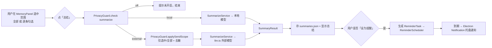

# 记忆工具 · 扩展版架构设计 v2（记事本形态）

> 架构师：高见远 ｜ 日期：2026-11-08
> 输入：`MEMORY-TOOL-ARCHITECTURE.md`（v1，上一轮）+ 用户本轮 10 条澄清与扩展
> 范围声明：本阶段**只出架构与设计，不写实现代码**；数据同步明确为"后置项"，本轮只预留扩展点。

---

## 0. 一句话结论

**把「记忆工具」做成 Prompt Scaffold 同一个 Electron 应用内的新顶级模块「记忆（记事本）」——一个轻量的 note-taking 面板；所有 AI 能力（输入增强 / 总结 / 提醒 / 代码执行）都以「用户自选的三档隐私开关」包裹、默认关闭；个人版 / 企业版用一套代码 + feature flag 支撑；数据同步明确后置，本轮只留扩展点。**

---

## 1. 产品定位

### 1.1 结论：同一应用内的新顶级模块，不是独立产品，也不是"知识管理平台"

- **形态 = 记事本**：定位为「轻量、随手记、按时间回看」的 note-taking 工具，不是 Notion/Obsidian 级的知识管理平台。设计红线：**不上向量库、不上图数据库、不做复杂工作流**，一切围绕"记一条、找得到、改不坏、丢不了、可选 AI 帮忙"。
- **与 Prompt Scaffold 的关系 = 同一个 Electron 应用里的新模块**，与「维度清单 / 对话总结 / 需求底稿」并列，成为主窗口顶部的一个 Tab（记忆）。理由三条：
  1. **基建 100% 复用**：窗口、托盘、`store.ts` 原子写、`llm.ts`、i18n、导入导出、测试框架全部现成，独立应用要重搭一遍、成本翻倍价值减半。
  2. **维度清单增强输入强依赖 Scaffold 现有能力**（见 §4.3 链路①）：记事编辑器里的「补全维度」入口直接复用 `LLMProvider.generateDimensions` + `DimensionList` 交互 + 规则维度池兜底，这在独立应用里需要重新实现。
  3. **数据天然打通**：记忆条目可被"提升为长期维度措辞习惯"（写入 `dimensionHabits`）、需求底稿可归档为记忆，三者共享同一套本地存储与确认交互（"AI 提议 / 用户采纳"）。

### 1.2 一句话定位（给产品）

> Prompt Scaffold 由「维度清单 + 对话总结 + 需求底稿 + 记忆（记事本）」组成；「记忆」是轻量记事本：**记、找、版本、备份、时段回看全在本机零成本完成；AI 总结 / 提醒 / 代码执行 / 输入增强都是可选增强项，默认关闭、用户自选引擎与发送范围；同步后置，先本地后云端。**

---

## 2. 核心权限 / 隐私模型（用户可自主控制）

### 2.1 AI 范围三档 + 数据发送范围

每个 AI 能力（输入增强 / 总结 / 提醒 / 代码执行）都独立可配为三档；"外部模型"档再叠加"发送范围"子选择。

| AI 范围档 | 含义 | 数据流向 | 隐私等级 | 能力边界 |
|---|---|---|---|---|
| **关闭（Off）** | 该能力不调用任何模型 | 数据不出机 | 🟢 最高 | 能力为空（UI 明示"未开启 AI"） |
| **本地模型（Local）** | 调用本机推理（Ollama / 本地小模型，如 SmolStruct 类） | 数据不出机 | 🟢 高 | 能力中等（小模型总结/提取够用） |
| **外部模型（External）** | 调用云端 LLM API（复用现有 `llm.ts`，用户自备 key） | 数据出机（明文发送） | 🟡 低 | 能力最强 |

**外部模型下的「发送范围」子选择**（仅 External 档生效）：

| 发送范围 | 含义 | 隐私权衡 |
|---|---|---|
| **全部（All）** | 选中范围内的所有条目**全文**发送 | 效果最好，暴露面最大 |
| **仅选中（Selected only）** | 只发送用户**逐条勾选**的条目；未勾选的仅以"条目标题 + 去敏摘要"形式参与；勾选条目支持**字段级脱敏**（如只发标题不发正文、正文脱敏后再发） | 效果略降，暴露面可控 |

### 2.2 能力清单（一张表看懂"用户能自主控制什么"）

| 能力 | 默认 | 三档可配 | 发送范围可配 | 附注 |
|---|---|---|---|---|
| **AI 输入增强**（补全维度） | 关 | 关/本地/外部 | 外部下：全部/仅选中 | 复用 Scaffold 维度清单；不增强也能记 |
| **AI 总结** | 关 | 关/本地/外部 | 外部下：全部/仅选中 | 手动触发优先 |
| **AI 提醒** | 关 | 关/本地/外部 | 外部下：全部/仅选中 | 提醒本体是本地托盘通知，AI 只生成"提醒文案" |
| **AI 代码执行** | 关（最敏感） | 关/本地沙箱/远端容器 | 远端下：仅选中代码片段 | 见 §6.4，默认关闭且需二次确认 |
| **版本控制** | 关 | 开/关 + 保留 N 版 | — | 文本默认完整快照；二进制走内容寻址去重 |
| **备份** | 用户自选 | 关/本地/云 | — | 本地省事占空间；云省空间但调用麻烦+有泄露风险 |
| **数据同步** | 不做（后置） | — | — | 本轮仅预留扩展点，见 §7 |

### 2.3 UI 交互：一眼看清"数据去哪了"

- **「隐私控制中心」面板**（`PrivacySettings.tsx`，全局唯一入口）：
  - 顶部**一键全关 AI 逃生舱**开关（master kill switch）。
  - 下方每个能力一行，用**三段控件（Segmented）**呈现 `关闭 / 本地 / 外部`，并带数据流向图标：🔒本地（锁）、☁️外部（云）。
  - 当某能力 = 外部时，该行展开「发送范围」子选择：`全部 / 仅选中`，并显示当前会外发的**条目数量**预览（"本次将发送 3 条、2 条仅标题去敏"）。
  - 任何"出机"动作前，弹**一次性确认**（明示：发送到哪个 baseURL、多少字、含不含二进制抽取文本），用户可取消。
- **编辑器内联提示**：记事编辑器顶部常驻一条小徽标，实时反映当前 AI 档位（如 `☁️ 外部 · 全部` / `🔒 本地` / `AI 已关`），用户不离开编辑界面就能看到隐私状态。

---

## 3. 数据模型

> 存储延续 v1 结论：**JSON 分文件 + `store.ts` 原子写**，不引入 SQLite（Electron 34 内置 Node 20.18，无 `node:sqlite`；本机无 MSVC 编译 native 模块）。二进制文件本体入仓库目录 `files/blobs/<sha256>`（内容寻址，天然去重），元数据入 JSON。

### 3.1 实体 schema（TypeScript 形式）

```ts
// ===== 核心：记事条目 =====
interface Note {
  id: string
  title?: string                 // 可选；空则取正文首行
  content: string                // 正文
  format: 'text' | 'markdown'
  kind: 'note' | 'todo' | 'insight' | 'snippet' | 'constraint'   // 轻分类，可扩展
  tags: string[]
  dimensionFields: DimensionField[]   // 维度清单增强的结构化字段（可选）
  aiSource: 'none' | 'manual' | 'enhanced'   // 是否经过维度增强
  cycleFolderId?: string         // 归属显式周期文件夹（可选）
  pinned: boolean
  archived: boolean              // 软删除（回收站）
  createdAt: string              // ISO 8601 UTC，用于派生时段视图
  updatedAt: string
}

interface DimensionField { name: string; value: string }   // 维度增强产物，如 {name:'篇幅', value:'800字'}

// ===== 显式周期文件夹（与派生视图并存）=====
interface CycleFolder {
  id: string
  name: string                   // 用户命名，如 "2026-11 第2周"
  scope: 'day' | 'week' | 'month' | 'custom'
  startDate: string              // ISO date
  endDate: string
  noteIds: string[]              // 归档进来的笔记
  archived: boolean
  createdAt: string
}

// ===== 资料（含二进制）=====
interface Material {
  id: string
  title: string
  fileName: string
  mimeType: string
  category: 'text' | 'markdown' | 'pdf' | 'office' | 'image' | 'other'
  blobRef: string                // 指向 files/blobs/<sha256>（当前版本）
  size: number
  checksum: string
  extractedTextRef?: string      // 指向 extracted/<id>.txt（可搜索的抽取文本）
  extractedStatus: 'none' | 'ok' | 'partial' | 'unsupported'
  tags: string[]
  currentVersionId?: string
  archived: boolean
  createdAt: string
  updatedAt: string
}

// ===== 版本快照（append-only；文本=完整快照，二进制=内容寻址去重）=====
interface NoteVersion {
  id: string
  noteId: string
  versionNo: number
  content: string                // 完整文本快照（小）
  checksum: string
  note: string                   // 变更说明
  createdAt: string
}

interface MaterialVersion {
  id: string
  materialId: string
  versionNo: number
  blobRef: string                // 指向 blobs/<sha256>；相同内容自动去重，不重复占空间
  size: number
  checksum: string
  note: string
  createdAt: string
}

// ===== 提醒 / 总结 / 代码执行 =====
interface ReminderTask {
  id: string
  noteId?: string
  materialId?: string
  remindAt: string
  repeat: 'none' | 'daily' | 'weekly' | 'monthly'
  status: 'pending' | 'fired' | 'dismissed'
  channel: 'tray'                // MVP 仅托盘
  aiSummaryId?: string           // 可关联一条 AI 总结作为提醒文案
}

interface SummaryResult {
  id: string
  sourceNoteIds: string[]
  engine: 'local' | 'external' | 'none'   // 实际使用的引擎
  sendScope: 'all' | 'selected'           // 实际发送范围
  content: string
  createdAt: string
}

interface AiExecutionTask {
  id: string
  noteId?: string
  language: string               // python / js / ts / ...
  codeSnippet: string
  sandbox: 'local' | 'remote'
  status: 'queued' | 'running' | 'success' | 'failed' | 'timeout' | 'denied'
  stdout: string
  stderr: string
  result?: string
  createdAt: string
}

// ===== 备份 =====
interface BackupManifest {
  id: string
  path: string
  location: 'local' | 'cloud'
  scope: 'full' | 'incremental'
  size: number
  checksum: string
  createdAt: string
}

// ===== 配置（隐私 / 版本 / 存储 / 双版本）=====
type AiScope = 'off' | 'local' | 'external'
type SendScope = 'all' | 'selected'

interface PrivacyConfig {
  masterAiKill: boolean          // 一键全关 AI 逃生舱
  capabilities: {
    enhance: AiScope             // 输入增强
    summarize: AiScope           // 总结
    remind: AiScope              // 提醒文案
    codeExec: AiScope            // 代码执行
  }
  sendScope: SendScope           // 外部模型时的默认发送范围
}

interface VersionConfig {
  enabled: boolean               // 用户自选开关
  keepVersions: number           // 保留最近 N 版
  keepDays?: number              // 或保留最近 M 天
  binaryPolicy: 'content-addressed' | 'reference-only' | 'off'   // 二进制版本策略
}

interface StorageConfig {
  cleanupReminder: {             // 三维度清理提醒（用户拍板）
    byVersions: number[]         // 按版本数提醒，如 [3, 5]
    byBytes: number[]            // 按占用空间提醒，如 [1GB, 2GB]
    byIntervalDays: number[]     // 按时间间隔提醒（天），如 [7, 15, 30]
  }
  backupPolicy: 'off' | 'local' | 'cloud'
  backupRotation: number         // 保留 N 份
}

interface EditionConfig {
  edition: 'personal' | 'enterprise'
  features: Record<string, boolean>   // feature flag 能力开关（双版本）
  licenseValidUntil?: string
}
```

### 3.2 物理存储分区（数据目录内，避免一损俱损）

```
<userData>/memory/
  ├── notes.json              # Note + DimensionField
  ├── cycle-folders.json      # CycleFolder
  ├── materials.json          # Material 元数据
  ├── reminders.json          # ReminderTask
  ├── summaries.json          # SummaryResult
  ├── ai-tasks.json           # AiExecutionTask
  ├── settings.json           # PrivacyConfig + VersionConfig + StorageConfig + EditionConfig
  ├── backup-manifest.json    # BackupManifest 清单
  ├── files/
  │   └── blobs/<sha256>      # 资料二进制 + 二进制版本（内容寻址，跨版本去重）
  ├── extracted/<id>.txt      # 二进制抽取文本缓存（用于搜索 + 预览）
  ├── search-index/           # MiniSearch 序列化索引
  ├── versions/               # NoteVersion（文本快照，独立区）
  └── backups/                # 备份产物（独立区，与源数据隔离）
```

---

## 4. 模块划分 + 数据流

### 4.1 模块划分（文件清单）

```
src/main/memory/                    # 主进程 · 记忆系统模块
  memory-store.ts                   # Note + CycleFolder CRUD + 天/周/月派生视图聚合
  material-store.ts                 # Material + MaterialVersion（内容寻址 blob）
  extract.ts                        # PDF/Office 文本抽取（pdfjs-dist / mammoth / jszip）
  search-index.ts                   # MiniSearch 索引（文本直接、二进制用抽取文本）
  version-manager.ts                # 版本快照 + 保留策略 + 历史版本清理建议
  backup-manager.ts                 # 本地/云备份 + 轮转 + 恢复 + 存储配额统计
  reminder-scheduler.ts             # 托盘提醒调度（定时器回调内 try-catch）
  summarize.ts                      # AI 总结（三档，复用 llm.ts）
  enhance.ts                        # 维度清单增强输入（复用 Scaffold 能力）
  code-sandbox.ts                   # AI 代码执行（本地 node:vm / 远端容器）
  privacy-guard.ts                  # 隐私档位校验 + 发送范围裁剪（横切，所有出机动作必经）
  feature-gate.ts                   # 双版本能力开关（个人/企业）
src/shared/
  memory-types.ts                   # 全部实体类型 + schema 常量（契约单一来源）
  privacy-types.ts                  # AiScope / SendScope / PrivacyConfig
  memory-io.ts                      # 导入/导出/合并/校验（纯函数，可单测）
src/renderer/components/
  MemoryPanel.tsx                   # 记事本主面板（列表/编辑/时段视图切换）
  NoteEditor.tsx                    # 记事编辑器（含「补全维度」入口 + 隐私徽标）
  CycleFolderView.tsx               # 周期文件夹管理
  MaterialLibrary.tsx               # 资料仓库
  VersionHistory.tsx                # 版本历史/回滚
  RecycleBin.tsx                    # 回收站
  BackupPanel.tsx                   # 备份/恢复/配额预警
  SearchBar.tsx                     # 全局搜索（笔记 + 资料抽取文本）
  PrivacySettings.tsx               # 隐私/权限控制中心
  AiSummaryPanel.tsx                # AI 总结 + 提醒
  CodeSandboxPanel.tsx              # AI 代码执行
  EnhanceDialog.tsx                 # 维度清单增强弹窗（复用 DimensionList）
src/preload/index.ts                # 暴露 memory:* / privacy:* / sandbox:* IPC
src/main/ipc.ts                     # 注册新 handler
```

### 4.2 类图

```mermaid
classDiagram
    class Note {
        +string id
        +string content
        +string format
        +string kind
        +string[] tags
        +DimensionField[] dimensionFields
        +string aiSource
        +string cycleFolderId
        +bool pinned
        +bool archived
        +string createdAt
        +string updatedAt
    }
    class DimensionField {
        +string name
        +string value
    }
    class CycleFolder {
        +string id
        +string name
        +string scope
        +string startDate
        +string endDate
        +string[] noteIds
        +bool archived
    }
    class Material {
        +string id
        +string title
        +string fileName
        +string mimeType
        +string category
        +string blobRef
        +number size
        +string checksum
        +string extractedTextRef
        +string extractedStatus
        +string[] tags
        +string currentVersionId
        +bool archived
    }
    class NoteVersion {
        +string id
        +string noteId
        +number versionNo
        +string content
        +string checksum
        +string note
    }
    class MaterialVersion {
        +string id
        +string materialId
        +number versionNo
        +string blobRef
        +number size
        +string checksum
        +string note
    }
    class ReminderTask {
        +string id
        +string noteId
        +string remindAt
        +string repeat
        +string status
        +string channel
    }
    class SummaryResult {
        +string id
        +string[] sourceNoteIds
        +string engine
        +string sendScope
        +string content
    }
    class AiExecutionTask {
        +string id
        +string language
        +string codeSnippet
        +string sandbox
        +string status
        +string stdout
        +string stderr
    }
    class BackupManifest {
        +string id
        +string path
        +string location
        +string scope
        +number size
        +string checksum
    }
    class PrivacyConfig {
        +bool masterAiKill
        +map capabilities
        +string sendScope
    }
    class VersionConfig {
        +bool enabled
        +number keepVersions
        +string binaryPolicy
    }
    class StorageConfig {
        +number quotaWarnBytes
        +string backupPolicy
        +number backupRotation
    }
    class EditionConfig {
        +string edition
        +map features
        +string licenseValidUntil
    }
    class MemoryStore {
        +createNote(note) Note
        +updateNote(id, patch) Note
        +listByPeriod(period) Note[]
        +createCycleFolder(folder) CycleFolder
        +archiveToFolder(noteId, folderId) void
    }
    class MaterialStore {
        +addMaterial(file) Material
        +extractAndIndex(material) void
        +list() Material[]
    }
    class SearchIndex {
        +build() void
        +addNote(note) void
        +addExtractedText(materialId, text) void
        +search(query) Result[]
    }
    class VersionManager {
        +snapshot(noteOrMaterial) void
        +listVersions(targetId) Version[]
        +restore(versionId) void
        +suggestCleanup() CleanupItem[]
    }
    class BackupManager {
        +backup(location) BackupManifest
        +restore(manifest) void
        +rotation() void
        +quotaStats() QuotaStats
    }
    class ReminderScheduler {
        +start() void
        +schedule(task) void
        +tick() void
    }
    class SummarizeService {
        +summarize(noteIds, scope) SummaryResult
    }
    class EnhanceService {
        +enhance(text) DimensionField[]
    }
    class CodeSandbox {
        +run(task) AiExecutionTask
    }
    class PrivacyGuard {
        +check(capability) void
        +applySendScope(notes, scope) Notes[]
    }
    class FeatureGate {
        +isEnabled(feature) bool
        +edition() string
    }

    Note --> DimensionField
    Note --> CycleFolder
    Note --> NoteVersion
    Material --> MaterialVersion
    Note --> ReminderTask
    Note --> SummaryResult
    Note --> AiExecutionTask

    MemoryStore --> Note
    MemoryStore --> CycleFolder
    MaterialStore --> Material
    MaterialStore --> SearchIndex
    VersionManager --> NoteVersion
    VersionManager --> MaterialVersion
    BackupManager --> BackupManifest
    ReminderScheduler --> ReminderTask
    SummarizeService --> SummaryResult
    CodeSandbox --> AiExecutionTask

    SummarizeService --> PrivacyGuard
    EnhanceService --> PrivacyGuard
    CodeSandbox --> PrivacyGuard
    PrivacyGuard --> PrivacyConfig
    FeatureGate --> EditionConfig
    VersionManager --> VersionConfig
    BackupManager --> StorageConfig
```



### 4.3 数据流（两条关键链路）

#### 链路①：输入增强（输入 → 维度清单 → 增强 → 存记忆）

```mermaid
flowchart LR
    A[用户在 NoteEditor 输入一段话] --> B{点「补全维度」}
    B --> C[PrivacyGuard.check enhance]
    C -->|off| D[仅用规则维度池兜底<br/>不调用模型]
    C -->|local| E[EnhanceService → 本地模型<br/>或规则维度池]
    C -->|external| F[PrivacyGuard.applySendScope<br/>裁剪发送内容]
    F --> G[EnhanceService → llm.ts 外部模型]
    D --> H[返回 Dimension[]]
    E --> H
    G --> H
    H --> I[EnhanceDialog 渲染可勾选清单<br/>复用 DimensionList]
    I --> J[用户勾选/编辑/删除]
    J --> K[产出 dimensionFields + 追加正文<br/>遵守「不静默改写」]
    K --> L[MemoryStore.create/update Note]
```

#### 链路②：AI 总结（选中范围 → 外部/本地模型 → 总结 → 提醒）



---

## 5. 双版本边界（个人版 vs 企业版）

### 5.1 功能差异表

| 能力 | 个人版 | 企业版 | 备注 |
|---|---|---|---|
| 记事 / 找 / 版本 / 本地备份 | ✅ 全量 | ✅ 全量 | 核心能力两版一致 |
| AI 三档（增强/总结/提醒） | ✅ | ✅ | 个人可接自备 key |
| AI 代码执行 | 🟡 仅本地沙箱（node:vm） | ✅ 本地沙箱 + 远端容器（可接自建） | 远端容器归企业版 |
| 团队 / 共享空间 | ❌ | ✅（界定，不深入） | 多用户共享记事空间 |
| 权限 / 角色 | ❌ | ✅（界定，不深入） | 只读/编辑/管理 |
| 审计日志 | ❌ | ✅（界定，不深入） | 谁在何时改了什么 |
| 批量操作 | 🟡 基础（批量导出/清空） | ✅ 批量导入/批量标记/批量归档 | |
| 云端备份 | 🟡 可接第三方（有泄露风险提示） | ✅ 自建/托管后端 | |
| 数据同步 | 后置 | 后置（企业版可能优先需要） | 本轮都不做 |

> **本轮只界定企业版差异边界，不深入设计**团队空间/权限/审计的具体 schema 与交互。**用户已拍板：下一轮单独出一份企业版详细设计**（团队空间 / 权限角色 / 审计日志的具体数据模型与交互）。

### 5.2 一套代码如何支撑双版本

- **编译期 + 运行期双层开关**：
  - 运行期：`settings.json` 里的 `EditionConfig.edition` + `features` 映射。主进程 `feature-gate.ts` 是唯一裁决点，所有企业版能力入口都过 `featureGate.isEnabled('teamSpace')` 这类判断。
  - 渲染期：企业版组件用 `FeatureGate` 包裹，`features` 关闭时组件不渲染（或显示"企业版专属"提示）。
  - 编译期（可选）：打包脚本按 `EDITION=enterprise` 环境变量裁剪企业版代码，减小个人版包体（后置，非首版必须）。
- **企业版后端（未来）**：团队空间/审计/远端容器需云端后端；个人版走纯本地零后端路径。**同一代码库**通过 feature flag 决定是否启用这些远端依赖，个人版不加载任何企业后端代码路径。
- **license 校验**：企业版能力通过 `licenseValidUntil` 校验（本机校验为主，不依赖在线校验，符合离线可用原则）。

---

## 6. 关键难点逐一给方案

### 6.1 PDF/Office 的文本抽取与搜索

- **分层策略**：
  - **文本 / Markdown**：直接入 `search-index.ts`（MiniSearch，前缀 + 模糊 + 字段权重）。
  - **PDF**：`pdfjs-dist`（纯 JS，Mozilla 官方，零 native）抽取文本层；**扫描版 PDF（无文本层）** → 可选 `tesseract.js`（纯 WASM）OCR，标记 `extractedStatus: 'partial'`，成本高故默认关闭、按需触发。
  - **Office 新格式**：`mammoth`（docx→text）、`jszip` 解包 + XML 抽文本（xlsx/pptx 的 sharedStrings/slide 文本）。
  - **Office 旧格式（.doc/.xls/.ppt，OLE 二进制）**：**不支持抽取**，`extractedStatus: 'unsupported'`，仅存原文件，提示用户转存新版格式。
- **两层模型（核心）**：`原文件保留（blob）+ 抽取文本缓存（extracted/<id>.txt）`。搜索**只索引抽取文本**，二进制本体绝不进索引；抽取文本同时用于"资料预览"和"AI 总结时只发文本不发二进制"（进一步降隐私暴露）。

### 6.2 二进制快照体积控制

- **内容寻址存储（content-addressed blob）**：文件按内容 SHA-256 存 `files/blobs/<sha256>`，`Material.currentVersionId` 和 `MaterialVersion.blobRef` 都指向 blob。**相同内容（如未修改的文件）自动去重**，只对变化内容多占空间——git 的思路、但去掉 git 的复杂度。
- **版本策略三档（用户自选 `binaryPolicy`）**：
  1. `content-addressed`（默认）：每次修改生成新 blob，可完整回滚到任意历史版，体积随变化量增长。
  2. `reference-only`：只记版本元数据 + checksum，文件本体单份保留（不可回滚旧内容，最省空间）。
  3. `off`：资料不记版本。
- **文本快照成本低**：`NoteVersion` 存完整文本，万级条目前无需 diff/压缩。

### 6.3 历史版本清理提醒（三维度独立提醒 + 清理建议）

**清理提醒采用三维度独立策略**（用户拍板），任一维度命中即触发托盘提醒，各维度阈值用户可分别设置：

| 维度 | 触发条件（示例） | 可配置项 |
|---|---|---|
| **按版本数** | 某条目历史版本累计达到 3 次、5 次… | `byVersions: [3, 5]` |
| **按占用空间** | 数据占用达到 1GB、2GB… | `byBytes: [1GB, 2GB]` |
| **按时间** | 每隔一周、半个月、一个月… | `byIntervalDays: [7, 15, 30]` |

- **配额统计**：`backup-manager.ts` 实时统计 `files/ + versions/ + extracted/ + backups/` 体积与版本数，`reminder-scheduler.ts` 按上述三维度阈值比对，命中即托盘通知 + `BackupPanel` 标红。
- **清理建议（不自动删，只建议）**：`version-manager.ts` 生成三类可清理项，用户勾选后手动删除：
  1. 超过 `keepVersions` 的**旧历史版本**（自动列出）。
  2. 未被任何版本/资料引用的**孤儿 blob**（内容寻址带来的可 GC 对象）。
  3. 超过 `backupRotation` 的**过期备份**。
- **原则**：删除是软删除 / 用户显式确认，绝不自动物理删除（延续 v1"永不自动删"铁律）。

### 6.4 AI 代码执行的沙箱选型与隐私边界

| 方案 | 隐私 | 能力 | 成本 | 结论 |
|---|---|---|---|---|
| **本地沙箱（node:vm）** | 🟢 代码不出机 | 仅纯 JS/TS 计算，禁 `require`/`fs`/`net`/`process`，可设超时 + 内存上限 | 零（Electron 内置 `node:vm`） | ✅ P1 落地，默认关闭 |
| **远端容器（自建/第三方，E2B 类）** | 🟡 代码上传 | Python/第三方库/文件全能力 | 高（需后端/第三方） | 🟡 归企业版 P2，用户主动开启 |

- **隐私边界三档（与 AI 范围一致）**：`关闭（默认）/ 本地沙箱 / 远端容器`。
- **本地沙箱**：`node:vm` 独立 context，白名单注入极少数纯函数（如 `JSON`、`Math`），**禁一切 I/O 与网络**；外层 `child_process` 起子进程跑 vm（隔离更稳）并加 `--max-old-space-size` 与超时 kill；超时/异常一律 `timeout`/`failed`，绝不影响主进程。
- **远端容器**：启用前**二次确认**，明示"代码将被上传到 X 环境执行"；发送范围**仅选中代码片段**（可附带用户勾选的输入数据），结果回传后本地留存、不自动回写原笔记。
- **默认关闭**是硬要求：这是隐私敏感度最高的能力。**用户已拍板：首版只做「本地 node:vm 沙箱」一档，远端容器明确后置到企业版 P2**（启用前二次确认、仅发送选中代码片段）。

---

## 7. 分阶段路线

| 阶段 | 内容 | 云端/后端投入 | 新增依赖（均纯 JS，零 native） | 说明 |
|---|---|---|---|---|
| **P0（本机零成本）** | 记事条目 CRUD + 天/周/月**派生视图** + **显式周期文件夹** + 资料仓库（文本/MD + 二进制 blob 收纳）+ **版本控制**（文本完整快照 + 二进制内容寻址）+ **MiniSearch 搜索** + 回收站软删除 + 导入/导出 + **本地备份** + 存储配额统计 | 无 | `minisearch` | 纯复用现有 JSON 存储 + React |
| **P1（本机 + 轻度 AI）** | **维度清单增强输入**（复用 Scaffold）+ **AI 总结**（三档，默认关）+ **本地托盘提醒** + **PDF/Office 文本抽取与搜索** + **AI 代码执行（本地 node:vm 沙箱）** + 历史版本清理提醒 + （可选）本地静态加密 | 无 | `pdfjs-dist`、`mammoth`、`jszip`、（可选）`tesseract.js` | AI 复用 `llm.ts`；提醒不承诺退出后送达 |
| **P2（需后端/投入）** | **企业版**（团队空间/权限/审计，界定后实现）+ **远端代码执行容器** + **云端备份** + 语义向量检索（仅当数据量到十万级且用户明确需要） | **需要**（账号/后端 or 第三方） | embedding 服务 + 后端 | 企业版需验证真实需求后再做 |
| **后置项（P2 之外，单独立项）** | **数据同步（跨设备）** | **需要**（端到端加密云同步 or WebDAV/S3 第三方） | 后端/第三方 | **本轮不做**，仅预留扩展点（`memory-io` 导入导出即同步的"手动版"雏形；未来同步模块走独立 `sync-provider` 接口，不侵入现有存储） |

**同步扩展点预留**（不设计细节）：在 `memory-io.ts` 的导入/导出/合并之上，预留一个 `SyncProvider` 接口（`push/pull/conflictResolve`），未来接端到端加密云同步或 WebDAV/S3 时只实现该接口，不动 `MemoryStore`/`MaterialStore` 本体。

---

## 8. 风险与合规

| # | 风险 | 影响 | 缓解 |
|---|---|---|---|
| 1 | **外部 AI 发送用户记忆/资料抽取文本** | 隐私泄露、合规风险 | 三档默认关闭 + 一次性确认明示流向 + 发送范围（全部/仅选中）+ 仅发抽取文本不发二进制 + 一键逃生舱 |
| 2 | **AI 代码执行上传代码** | 代码隐私泄露、代码注入 | 默认关闭 + 本地 node:vm 优先（代码不出机）+ 远端二次确认 + 禁网络/fs/require + 超时 |
| 3 | **历史版本/备份膨胀占空间** | 磁盘耗尽、体验下降 | 内容寻址去重 + 配额预警 + 清理建议（不自动删）+ 二进制版本策略可关 |
| 4 | **清理/删除误伤数据** | 不可逆丢失 | 软删除 + 回收站 + 清理须用户显式勾选确认 + 备份独立区 |
| 5 | **提醒"退出后不送达"被误解** | 预期落差 | 明示"应用运行时提醒"；跨设备推送归入同步后置项 |
| 6 | **二进制抽取失败/旧格式不支持** | 搜索不到资料 | `extractedStatus` 明示（ok/partial/unsupported）+ 提示转存新版 + 原文件仍可打开 |
| 7 | **双版本复杂度** | 代码分叉、维护成本 | feature flag 单一裁决点 + 个人版不加载企业后端路径 + 编译期裁剪（后置） |
| 8 | **合规（PIPL 数据出境 / 委托处理）** | 法律风险 | 外部 AI 与云备份均需用户知情同意 + 最小化 + 可删除；本地默认不构成对外传输；不采集不埋点；敏感行业提示"本地工具不构成合规存储" |

### 合规专项

1. **个人信息保护（中国 PIPL）**：记忆/资料极可能含个人信息。默认本地存储不构成对外传输；一旦走"外部模型 / 云端备份 / 企业版后端"，即涉"对外提供/委托处理"，需**用户知情同意 + 最小化 + 可删除 + 数据出境评估**（用海外 LLM API 时尤其）。
2. **数据最小化**：外部发送默认"仅选中"、二进制只发抽取文本、代码只发选中片段。
3. **被遗忘权**：提供"一键导出 + 彻底删除"，删除要真删（含版本、抽取文本、备份、索引）。
4. **不采集、不埋点**：延续现状，从源头降合规面。

---

## 附：本轮已确认决策（用户拍板 2026-11-08）

1. **企业版** → 需要：下一轮单独出「团队空间 / 权限 / 审计」的详细 schema 与交互设计。
2. **外部模型「仅选中」去敏粒度** → 需要更细：除「标题 + 去敏摘要」外，支持**字段级脱敏**（如只发标题、不发正文；正文脱敏后再发），发送前逐字段勾选确认。
3. **AI 代码执行首版** → 只做**本地 node:vm 沙箱一档**；远端容器明确后置到企业版 P2。
4. **存储清理提醒** → 采用**三维度独立提醒**（任一命中即提醒，各维度阈值用户可分别设置）：
   - **按版本数**：历史版本达到 3 次、5 次等时提醒；
   - **按占用空间**：数据占用达到 1GB、2GB 等时提醒；
   - **按时间**：每隔一周（7 天）、半个月（15 天）、一个月（30 天）等提醒一次。

---

*文档完 · 架构师 高见远（记忆工具扩展版 v2）*
